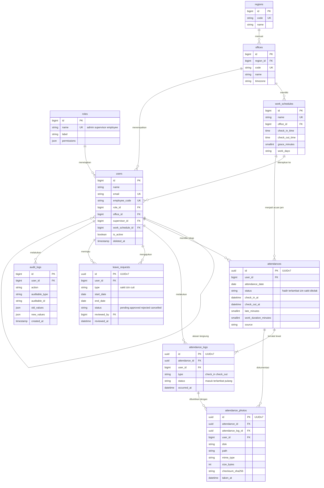

# Skema Database — Sistem Absensi Karyawan berbasis Webcam ("Presensi")

| Atribut | Nilai |
|---|---|
| Dokumen | `/docs/database.md` |
| Versi | 1.0 (DRAFT) |
| Tanggal | 2026-10-25 |
| Penulis | Tech Architect |
| Basis | `docs/brief.md` v1, `docs/DESIGN.md` (token visual), `docs/tasks.md` T-02, repo acuan `reference/absen-webcam-legacy/` (Laravel 5.4) |
| Target implementasi | Laravel 13 (PHP ≥ 8.3) + MySQL 8 + Tailwind CSS v4 |
| Sifat | **Kontrak data** untuk Backend & DevOps Engineer (penulis migrasi), Frontend Developer (kebutuhan data), dan QA & Security Reviewer (dasar uji) |

> **Penting.** Dokumen ini adalah **catatan rancangan**, bukan hasil setup server.
> Blok DDL SQL dan migrasi PHP di dalamnya adalah **referensi rancangan yang belum
> dieksekusi di environment produksi**. Lihat `§12 Status Verifikasi` untuk daftar
> hal yang sudah dan belum dibuktikan.

---

## §1 Ringkasan

### 1.1 Apa ini dalam bahasa non-teknis

Aplikasi ini menyimpan empat jenis informasi:

1. **Data orang** — siapa yang bekerja di perusahaan, perannya apa, kantor mana yang menjadi tempat kerjanya, dan jadwal kerja siapa.
2. **Data kehadiran** — kapan setiap karyawan datang dan pulang pada setiap hari.
3. **Data bukti** — foto wajah yang diambil dari webcam saat absen masuk dan absen pulang, beserta keterangan teknis file fotonya.
4. **Data pengajuan** — permintaan izin yang diajukan karyawan dan keputusan atasan atas permintaan tersebut.

### 1.2 Berapa banyak tabel

**17 tabel** terbagi dua:

| Kelompok | Jumlah | Nama |
|---|---|---|
| Inti aplikasi | 10 | `roles`, `users`, `regions`, `offices`, `work_schedules`, `attendances`, `attendance_logs`, `attendance_photos`, `leave_requests`, `audit_logs` |
| Bawaan framework Laravel 13 | 7 | `password_reset_tokens`, `sessions`, `cache`, `cache_locks`, `jobs`, `job_batches`, `failed_jobs` |

Enam tabel legacy (`users`, `absen`, `absen_masuk`, `absen_pulang`, `m_jam`, `m_atasan`) dirombak menjadi sepuluh tabel baru.

### 1.3 Tiga keputusan kunci dan alasannya

**Keputusan 1 — Foto tidak lagi disimpan di dalam database.**
Di sistem lama foto disimpan sebagai teks *base64* di kolom `TEXT`. Akibatnya setiap foto menambah ukuran baris tabel secara drastis, halaman riwayat menjadi sangat lambat saat tabel membesar, dan salinan foto ikut ter-*backup* setiap kali database dicadangkan. Pada skema baru foto disimpan sebagai **file di disk atau object storage**, sedangkan database hanya menyimpan **metadata foto** (lokasi file, tipe, ukuran, sidik jari/hash, waktu pengambilan) di tabel `attendance_photos`. Dampak: basis data tetap ramping, dan backup cukup mencadangkan file foto secara terpisah bila dibutuhkan.

**Keputusan 2 — Aturan "satu absen per karyawan per hari" dijamin oleh database.**
Di sistem lama aturan ini dicek di dalam kode PHP (`count()` lalu `if`), sehingga dua permintaan yang datang bersamaan bisa sama-sama lolos dan menghasilkan dua baris untuk hari yang sama. Pada skema baru aturan ini menjadi **kunci unik (`UNIQUE`)**: `UNIQUE (user_id, attendance_date)` pada tabel `attendances`. Percobaan absen ganda di hari yang sama ditolak oleh database, bukan oleh kode aplikasi.

**Keputusan 3 — Pengajuan izin menjadi tabel tersendiri.**
Di sistem lama izin dipaksakan masuk ke tabel `absen`: alasan izin ditumpangkan di kolom `keterangan`, lalu dibuat baris "dummy" di tabel `absen_masuk` dan `absen_pulang` tanpa foto. Akibatnya riwayat absensi bercampur dengan pengajuan izin dan tidak ada jejak siapa yang menyetujui. Pada skema baru pengajuan izin memakai tabel `leave_requests` yang punya status (`pending` / `approved` / `rejected` / `cancelled`), peninjau (`reviewed_by`), dan waktu peninjauan.

### 1.4 Prinsip yang berlaku di seluruh dokumen

| Prinsip | Penerapan |
|---|---|
| Nama tabel & kolom `snake_case` plural (konvensi Laravel) | `attendance_logs`, `work_schedules`, `leave_requests` |
| UUIDv7 untuk tabel yang tumbuh cepat | `attendances`, `attendance_logs`, `attendance_photos`, `leave_requests` |
| `BIGINT UNSIGNED` untuk tabel master kecil | `roles`, `users`, `regions`, `offices`, `work_schedules` |
| Waktu: `TIMESTAMP` untuk jejak teknik, `DATETIME` untuk kejadian bisnis | `created_at` vs `occurred_at` |
| Soft delete pada data yang boleh "dibatalkan" | `deleted_at` pada 8 tabel inti |
| Jejak audit siapa mengubah apa | `audit_logs` (append-only) |
| Tidak ada rahasia di database | Kredensial hanya lewat environment variable |

---

## §2 Inventaris Tabel

| Tabel | Tujuan (1 kalimat) | Estimasi baris/tahun | Asal legacy |
|---|---|---|---|
| `roles` | Menyimpan daftar peran pengguna. | 3 (konstan) | `users.level` |
| `users` | Menyimpan akun dan data profil setiap karyawan serta admin. | 60–120 (tetap) | `users` |
| `regions` | Menyimpan master daerah tempat kantor berada. | 5–20 | `m_atasan.daerah` |
| `offices` | Menyimpan master kantor/cabang beserta daerahnya. | 3–15 | `m_atasan.kantor` |
| `work_schedules` | Menyimpan aturan jam masuk, jam pulang, toleransi, dan hari kerja. | 5–30 | `m_jam` (singleton) |
| `attendances` | Menyimpan rekap kehadiran **satu hari per karyawan** beserta durasi kerja. | 15.000–50.000 | `absen` |
| `attendance_logs` | Menyimpan setiap kejadian absen (masuk / pulang) beserta waktunya. | 30.000–100.000 | `absen_masuk` + `absen_pulang` |
| `attendance_photos` | Menyimpan metadata file foto bukti absen (bukan isi fotonya). | 30.000–100.000 | kolom `photo` legacy |
| `leave_requests` | Menyimpan pengajuan izin/sakit/cuti beserta keputusan atasan. | 100–800 | tidak ada |
| `audit_logs` | Menyimpan jejak perubahan data penting: siapa, kapan, nilai lama & baru. | 5.000–50.000 | tidak ada |
| `password_reset_tokens` | Menyimpan token reset password (bawaan Laravel). | < 500 | `password_resets` |
| `sessions` | Menyimpan sesi login bila memakai session driver database. | 20–200 | tidak ada |
| `cache` | Menyimpan cache aplikasi (rate limit, cache rekap). | < 10.000 | tidak ada |
| `cache_locks` | Kunci eksklusif untuk operasi cache (mencegah stampede). | < 100 | tidak ada |
| `jobs` | Antrean pekerjaan latar (ekspor laporan besar, thumbnail). | < 50.000 | tidak ada |
| `job_batches` | Kelompokan pekerjaan latar yang diproses berbarengan. | < 1.000 | tidak ada |
| `failed_jobs` | Pekerjaan latar yang gagal dan perlu diperiksa ulang. | < 500 | tidak ada |

**Catatan estimasi.** Angka di atas adalah **perkiraan desain**, bukan hasil pengukuran — sistem lama tidak menyediakan statistik volume. Dasar perhitungannya: 1 perusahaan, 50–100 karyawan, 220 hari kerja efektif per tahun, 2 foto per hari per karyawan.

---

## §3 ERD (Diagram Relasi)



> Atribut di blok Mermaid sengaja diringkas. Tipe SQL lengkap, nilai default, nama index,
> dan perilaku `ON DELETE` ada di `§4`.

---

## §4 Detail Tabel & Kolom

Konvensi: `PK` = primary key, `UK` = unique key, `FK` = foreign key, `IDX` = index biasa.
`Y` = boleh `NULL`, `N` = wajib diisi. Semua kolom `created_at` / `updated_at` bertipe
`TIMESTAMP NULL DEFAULT NULL` (konvensi Laravel), kecuali `audit_logs.created_at` yang
`TIMESTAMP NOT NULL DEFAULT CURRENT_TIMESTAMP` (append-only).

### 4.1 `roles` — daftar peran

**Tujuan:** menyimpan nama peran yang dipakai mengatur hak akses. **Perkiraan baris:** 3.

| Kolom | Tipe SQL | Null? | Default | Kunci / Constraint | Keterangan |
|---|---|---|---|---|---|
| `id` | `BIGINT UNSIGNED` | N | — | **PK**, AUTO_INCREMENT | Pengenal peran. |
| `name` | `VARCHAR(50)` | N | — | **UK** `roles_name_unique` | Kode peran: `admin`, `supervisor`, `employee`. Dipakai kode, bukan nama tampilan. |
| `label` | `VARCHAR(100)` | N | — | IDX `roles_label_index` | Nama tampilan: "Administrator", "Supervisor", "Karyawan". Dipakai di sidebar & filter. |
| `description` | `VARCHAR(255)` | Y | `NULL` | — | Penjelasan singkat di halaman admin. |
| `permissions` | `JSON` | Y | `NULL` | — | Cadangan permission granular. v1: `NULL` (pembatasan lewat Policy Laravel). |
| `created_at` | `TIMESTAMP` | Y | `NULL` | — | Jejak waktu buat. |
| `updated_at` | `TIMESTAMP` | Y | `NULL` | — | Jejak waktu ubah. |

**Index:** `PRIMARY (id)` · `roles_name_unique (name)` · `roles_label_index (label)`.
**Relasi:** `roles.id` ← `users.role_id` (**ON DELETE RESTRICT** — peran tidak boleh dihapus selama masih dipakai).

### 4.2 `users` — karyawan & admin

**Tujuan:** menyimpan akun login dan data profil setiap orang yang memakai sistem. **Perkiraan baris:** 60–120. **Asal legacy:** tabel `users` + kolom `level`.

| Kolom | Tipe SQL | Null? | Default | Kunci / Constraint | Keterangan |
|---|---|---|---|---|---|
| `id` | `BIGINT UNSIGNED` | N | — | **PK**, AUTO_INCREMENT | Pengenal user. Dipertahankan `BIGINT` agar relasi cepat dan ID mudah dicatat manual. |
| `name` | `VARCHAR(255)` | N | — | IDX `users_name_index` | Nama lengkap karyawan (dari legacy `users.name`). |
| `employee_code` | `VARCHAR(50)` | Y | `NULL` | **UK** `users_employee_code_unique` | NIK. `NULL` untuk akun yang belum punya NIK. |
| `email` | `VARCHAR(255)` | N | — | **UK** `users_email_unique` | Email login (dari legacy `users.email`). |
| `email_verified_at` | `TIMESTAMP` | Y | `NULL` | — | Standar Laravel; diisi setelah verifikasi email. |
| `password` | `VARCHAR(255)` | N | — | — | Hash bcrypt/argon. **Tidak pernah** disimpan dalam bentuk biasa. Legacy memakai `bcrypt('123')` — tidak diteruskan. |
| `remember_token` | `VARCHAR(100)` | Y | `NULL` | — | Token "ingat saya" (standar Laravel 13). |
| `role_id` | `BIGINT UNSIGNED` | N | — | **FK** → `roles.id` (RESTRICT) | Peran user. Menggantikan kolom legacy `level`. |
| `office_id` | `BIGINT UNSIGNED` | Y | `NULL` | **FK** → `offices.id` (SET NULL) | Kantor tempat user bekerja. `NULL` = belum ditugaskan. |
| `supervisor_id` | `BIGINT UNSIGNED` | Y | `NULL` | **FK** → `users.id` (SET NULL) | Atasan langsung. `NULL` = belum ada atasan. Menggantikan master `m_atasan`. |
| `work_schedule_id` | `BIGINT UNSIGNED` | Y | `NULL` | **FK** → `work_schedules.id` (SET NULL) | Jadwal kerja yang berlaku. `NULL` = memakai jadwal bawaan kantor. |
| `is_active` | `TINYINT(1)` | N | `1` | IDX `users_is_active_index` | Nonaktifkan user tanpa menghapus riwayatnya. |
| `last_login_at` | `TIMESTAMP` | Y | `NULL` | — | Waktu login terakhir, untuk audit & deteksi anomali. |
| `failed_login_count` | `SMALLINT UNSIGNED` | N | `0` | — | Penghitung percobaan login gagal (rate limiting / lockout). |
| `locked_until` | `TIMESTAMP` | Y | `NULL` | IDX `users_locked_until_index` | Batas waktu akun terkunci. |
| `created_at` / `updated_at` | `TIMESTAMP` | Y | `NULL` | — | Jejak waktu. |
| `deleted_at` | `TIMESTAMP` | Y | `NULL` | — | Soft delete. |

**Index**

| Nama index | Kolom | Jenis | Alasan |
|---|---|---|---|
| `PRIMARY` | `id` | PK | Kunci utama user. |
| `users_email_unique` | `email` | UNIQUE | Identitas login; lookup tiap request autentikasi. |
| `users_employee_code_unique` | `employee_code` | UNIQUE | NIK tidak boleh ganda; `NULL` boleh berulang (MySQL mengabaikan NULL di unique index). |
| `users_name_index` | `name` | INDEX | Pencarian nama pada DataTables master karyawan. |
| `users_is_active_index` | `is_active` | INDEX | Filter user aktif (dipakai hampir di setiap listing). |
| `users_role_id_foreign` | `role_id` | INDEX | Wajib untuk FK; sekaligus filter "khusus karyawan" (pengganti `whereNull('level')` legacy). |
| `users_office_id_foreign` | `office_id` | INDEX | Wajib untuk FK; filter rekap per kantor. |
| `users_supervisor_id_foreign` | `supervisor_id` | INDEX | Wajib untuk FK; rekap "tim saya". |
| `users_work_schedule_id_foreign` | `work_schedule_id` | INDEX | Wajib untuk FK. |
| `users_locked_until_index` | `locked_until` | INDEX | Pembersihan akun terkunci oleh scheduled job. |

### 4.3 `regions` — master daerah

**Tujuan:** menyimpan daftar daerah tempat kantor berada. **Perkiraan baris:** 5–20. **Asal legacy:** `m_atasan.daerah`.

| Kolom | Tipe SQL | Null? | Default | Kunci / Constraint | Keterangan |
|---|---|---|---|---|---|
| `id` | `BIGINT UNSIGNED` | N | — | **PK**, AUTO_INCREMENT | Pengenal daerah. |
| `code` | `VARCHAR(20)` | N | — | **UK** `regions_code_unique` | Kode singkat, mis. `JKT`, `SBY`. Dipakai saat impor & integrasi. |
| `name` | `VARCHAR(115)` | N | — | IDX `regions_name_index` | Nama daerah, mis. "Jakarta". |
| `description` | `VARCHAR(255)` | Y | `NULL` | — | Keterangan tambahan. |
| `is_active` | `TINYINT(1)` | N | `1` | — | Nonaktifkan tanpa menghapus. |
| `created_at` / `updated_at` | `TIMESTAMP` | Y | `NULL` | — | Jejak waktu. |
| `deleted_at` | `TIMESTAMP` | Y | `NULL` | — | Soft delete. |

**Index:** `PRIMARY (id)` · `regions_code_unique (code)` · `regions_name_index (name)`.
**Relasi:** `regions.id` ← `offices.region_id` (**RESTRICT**).

### 4.4 `offices` — master kantor

**Tujuan:** menyimpan daftar kantor/cabang beserta daerah dan zona waktunya. **Perkiraan baris:** 3–15. **Asal legacy:** `m_atasan.kantor`.

| Kolom | Tipe SQL | Null? | Default | Kunci / Constraint | Keterangan |
|---|---|---|---|---|---|
| `id` | `BIGINT UNSIGNED` | N | — | **PK**, AUTO_INCREMENT | Pengenal kantor. |
| `region_id` | `BIGINT UNSIGNED` | N | — | **FK** → `regions.id` (RESTRICT) | Daerah tempat kantor berada. |
| `code` | `VARCHAR(20)` | N | — | **UK** `offices_code_unique` | Kode kantor, mis. `KTP-01`. |
| `name` | `VARCHAR(115)` | N | — | IDX `offices_name_index` | Nama kantor. |
| `address` | `VARCHAR(255)` | Y | `NULL` | — | Alamat lengkap; dipakai di kop laporan PDF. |
| `timezone` | `VARCHAR(64)` | N | `'Asia/Jakarta'` | — | Zona waktu. Penting untuk konsistensi "hari" saat absen. |
| `is_active` | `TINYINT(1)` | N | `1` | — | Nonaktifkan tanpa menghapus. |
| `created_at` / `updated_at` | `TIMESTAMP` | Y | `NULL` | — | Jejak waktu. |
| `deleted_at` | `TIMESTAMP` | Y | `NULL` | — | Soft delete. |

**Index:** `PRIMARY (id)` · `offices_code_unique (code)` · `offices_name_index (name)` · `offices_region_id_foreign (region_id)`.
**Relasi:** `offices.id` ← `users.office_id` (SET NULL), ← `work_schedules.office_id` (SET NULL).

### 4.5 `work_schedules` — master jam kerja

**Tujuan:** menyimpan aturan jam masuk, jam pulang, toleransi keterlambatan, dan hari kerja — dapat berbeda per kantor. **Perkiraan baris:** 5–30. **Asal legacy:** `m_jam` (singleton).

| Kolom | Tipe SQL | Null? | Default | Kunci / Constraint | Keterangan |
|---|---|---|---|---|---|
| `id` | `BIGINT UNSIGNED` | N | — | **PK**, AUTO_INCREMENT | Pengenal jadwal. |
| `name` | `VARCHAR(100)` | N | — | **UK** `work_schedules_name_unique` | Nama yang mudah dibaca, mis. "Kantor Pusat — Pagi". |
| `office_id` | `BIGINT UNSIGNED` | Y | `NULL` | **FK** → `offices.id` (SET NULL) | Kantor yang memakai jadwal ini. `NULL` = jadwal global untuk semua kantor. |
| `check_in_time` | `TIME` | N | — | — | Jam mulai kerja, mis. `08:00:00`. Legacy `m_jam.jam_masuk` menyimpan `datetime`, padahal hanya jamnya yang dipakai. |
| `check_out_time` | `TIME` | N | — | — | Jam selesai kerja, mis. `17:00:00`. |
| `grace_minutes` | `SMALLINT UNSIGNED` | N | `0` | — | Toleransi keterlambatan (menit). Absen sebelum `check_in_time + grace_minutes` tetap berstatus `hadir`. |
| `break_minutes` | `SMALLINT UNSIGNED` | N | `0` | — | Istirahat yang dipotong dari durasi kerja. |
| `work_days` | `VARCHAR(50)` | N | `'1,2,3,4,5'` | — | Hari kerja, daftar angka dipisah koma: `1`=Senin … `7`=Minggu, `0`=Ahad. |
| `is_active` | `TINYINT(1)` | N | `1` | IDX `work_schedules_is_active_index` | Jadwal nonaktif tidak dipakai lagi, historis tetap utuh. |
| `effective_from` | `DATE` | Y | `NULL` | — | Mulai berlaku (untuk riwayat perubahan aturan). |
| `effective_to` | `DATE` | Y | `NULL` | — | Berakhir berlaku. `NULL` = masih berlaku. |
| `created_at` / `updated_at` | `TIMESTAMP` | Y | `NULL` | — | Jejak waktu. |
| `deleted_at` | `TIMESTAMP` | Y | `NULL` | — | Soft delete. |

**Index:** `PRIMARY (id)` · `work_schedules_name_unique (name)` · `work_schedules_office_id_index (office_id)` · `work_schedules_is_active_index (is_active)`.
**Relasi:** `work_schedules.id` ← `users.work_schedule_id` (SET NULL), ← `attendances.work_schedule_id` (SET NULL).

> **Catatan desain — "jadwal bawaan" tanpa kolom flag.**
> Rancangan awal memakai kolom boolean `is_default` plus *generated column* untuk memaksa
> "hanya satu jadwal bawaan per kantor". Cara itu **ditolak** karena MariaDB 11.8 menolak
> *generated column* yang merujuk kolom foreign key (bukti di `§12.2`). Penggantinya:
> **jadwal bawaan suatu kantor diwujudkan lewat `users.work_schedule_id`** — admin menekan
> "Terapkan jadwal ini ke semua karyawan kantor X" dan aplikasi memperbarui kolom itu
> untuk seluruh user terkait. Satu kolom FK secara struktural sudah menjamin "maksimal
> satu jadwal bawaan per kantor", tanpa perlu indeks parsial.

### 4.6 `attendances` — rekap kehadiran harian

**Tujuan:** menyimpan **satu baris per karyawan per hari** — ringkasan kehadiran hari itu beserta durasi kerja. Inilah tabel yang dibaca halaman riwayat dan rekap. **Perkiraan baris:** 15.000–50.000/tahun. **Asal legacy:** `absen`.

| Kolom | Tipe SQL | Null? | Default | Kunci / Constraint | Keterangan |
|---|---|---|---|---|---|
| `id` | `CHAR(36)` | N | — | **PK** | UUIDv7 (`HasUuids` bawaan Laravel 13). |
| `user_id` | `BIGINT UNSIGNED` | N | — | **FK** → `users.id` (RESTRICT) | Pemilik rekap kehadiran. |
| `attendance_date` | `DATE` | N | — | bagian **UNIQUE** `attendances_user_date_unique` | Tanggal kehadiran (tanggal lokal kantor). Legacy memakai `datetime` jam 00:00 — dikoreksi menjadi `DATE`. |
| `status` | `ENUM('hadir','terlambat','izin','sakit','ditolak')` | N | `'hadir'` | IDX `attendances_status_date_index` | Status hari itu. Lihat `§5`. |
| `check_in_at` | `DATETIME` | Y | `NULL` | — | Waktu absen masuk sebenarnya (waktu server). |
| `check_out_at` | `DATETIME` | Y | `NULL` | — | Waktu absen pulang sebenarnya (waktu server). |
| `scheduled_check_in_at` | `DATETIME` | Y | `NULL` | — | Jam masuk seharusnya, digabung dengan tanggal → dipakai menghitung keterlambatan. |
| `scheduled_check_out_at` | `DATETIME` | Y | `NULL` | — | Jam pulang seharusnya, digabung dengan tanggal. |
| `late_minutes` | `SMALLINT UNSIGNED` | N | `0` | — | Menit keterlambatan (setelah dikurangi `grace_minutes`). |
| `early_leave_minutes` | `SMALLINT UNSIGNED` | N | `0` | — | Menit pulang lebih awal (menggantikan kode legacy "CP"). |
| `work_duration_minutes` | `SMALLINT UNSIGNED` | N | `0` | — | Durasi kerja bersih (masuk→pulang dikurangi istirahat). Dasar angka `stat-card`. |
| `overtime_minutes` | `SMALLINT UNSIGNED` | N | `0` | — | Menit lembur (pulang setelah jam pulang). |
| `work_schedule_id` | `BIGINT UNSIGNED` | Y | `NULL` | **FK** → `work_schedules.id` (SET NULL) | Jadwal yang dipakai hari itu (disalin, bukan referensi dinamis) agar riwayat tetap konsisten saat aturan berubah. |
| `source` | `ENUM('webcam','manual','import')` | N | `'webcam'` | — | Asal data: absen biasa, koreksi manual admin, atau impor data lama. |
| `notes` | `VARCHAR(255)` | Y | `NULL` | — | Catatan admin, mis. "koreksi setelah lupa absen". |
| `created_at` / `updated_at` | `TIMESTAMP` | Y | `NULL` | — | Jejak waktu. |
| `deleted_at` | `TIMESTAMP` | Y | `NULL` | — | Soft delete. |

**Index**

| Nama index | Kolom | Jenis | Alasan |
|---|---|---|---|
| `PRIMARY` | `id` | PK | Kunci acuan. |
| **`attendances_user_date_unique`** | `(user_id, attendance_date)` | **UNIQUE** | **Aturan inti: satu karyawan satu absen per hari.** Menolak duplikasi di level database, menutup celah race condition yang di legacy hanya dicek di PHP. |
| `attendances_date_status_index` | `(attendance_date, status)` | INDEX | Riwayat per periode + filter status (query utama tabel riwayat & DataTables server-side). |
| `attendances_status_date_index` | `(status, attendance_date)` | INDEX | Rekap per status dalam rentang tanggal (stat-card: total hadir / terlambat / izin). |
| `attendances_user_id_foreign` | `user_id` | INDEX | Wajib untuk FK (MySQL selalu memerlukan index pada kolom FK). |
| `attendances_work_schedule_id_foreign` | `work_schedule_id` | INDEX | Wajib untuk FK. |
| `attendances_created_at_index` | `created_at` | INDEX | Urutan bawaan DataTables (`ORDER BY created_at DESC`) seperti di legacy. |

**Relasi:** `attendances.id` ← `attendance_logs.attendance_id` (CASCADE), ← `attendance_photos.attendance_id` (CASCADE). `attendances.user_id` → `users.id` (**RESTRICT** — riwayat kehadiran tidak boleh ikut terhapus).

### 4.7 `attendance_logs` — kejadian absen (masuk / pulang)

**Tujuan:** menyimpan **setiap** kejadian absen sebagai baris sendiri, sehingga tabel `absen_masuk` dan `absen_pulang` yang terpisah di sistem lama bisa disatukan. **Perkiraan baris:** 30.000–100.000/tahun. **Asal legacy:** `absen_masuk` + `absen_pulang`.

| Kolom | Tipe SQL | Null? | Default | Kunci / Constraint | Keterangan |
|---|---|---|---|---|---|
| `id` | `CHAR(36)` | N | — | **PK** | UUIDv7. |
| `attendance_id` | `CHAR(36)` | N | — | **FK** → `attendances.id` (CASCADE) | Rekap harian yang memiliki kejadian ini. |
| `user_id` | `BIGINT UNSIGNED` | N | — | **FK** → `users.id` (RESTRICT) | User yang melakukan kejadian (denormalisasi ringan agar query cepat). |
| `type` | `ENUM('check_in','check_out')` | N | — | bagian **UNIQUE** `attendance_logs_attendance_type_unique` | Jenis kejadian. Menggantikan pemisahan tabel legacy. |
| `status` | `ENUM('masuk','terlambat','pulang')` | N | — | bagian **IDX** `attendance_logs_type_status_index` | Status kejadian ini. Lihat `§5`. |
| `occurred_at` | `DATETIME` | N | — | — | Waktu kejadian **di server** (bukan jam perangkat karyawan). Ini acuan resmi. |
| `scheduled_at` | `DATETIME` | Y | `NULL` | — | Jam yang seharusnya (acuan perhitungan terlambat). |
| `late_minutes` | `SMALLINT UNSIGNED` | N | `0` | — | Menit keterlambatan untuk kejadian ini. |
| `early_leave_minutes` | `SMALLINT UNSIGNED` | N | `0` | — | Menit pulang lebih awal untuk kejadian ini (menggantikan kode legacy "CP"). |
| `device_label` | `VARCHAR(100)` | Y | `NULL` | — | Keterangan perangkat ringkas, mis. "Chrome · Android 14". |
| `ip_address` | `VARCHAR(45)` | Y | `NULL` | — | Alamat IP (v4/v6) untuk audit, **tidak** untuk geolokasi pihak ketiga. |
| `user_agent` | `VARCHAR(255)` | Y | `NULL` | — | String user agent untuk audit. |
| `notes` | `VARCHAR(255)` | Y | `NULL` | — | Catatan tambahan. |
| `created_at` / `updated_at` | `TIMESTAMP` | Y | `NULL` | — | Jejak waktu. |
| `deleted_at` | `TIMESTAMP` | Y | `NULL` | — | Soft delete. |

**Index:** `PRIMARY (id)` · **`attendance_logs_attendance_type_unique (attendance_id, type)`** — satu rekap harian maksimal punya satu `check_in` dan satu `check_out`, menggantikan pengecekan `whereHas('pulangs')->count()` legacy · `attendance_logs_user_occurred_index (user_id, occurred_at)` — riwayat absen saya urut waktu · `attendance_logs_type_status_index (type, status)` — rekap jumlah check-in terlambat per periode · `attendance_logs_occurred_at_index (occurred_at)` — rentang waktu global untuk laporan · `attendance_logs_attendance_id_foreign (attendance_id)` dan `attendance_logs_user_id_foreign (user_id)` — wajib untuk FK.

**Relasi:** `attendance_logs.id` ← `attendance_photos.attendance_log_id` (CASCADE).

### 4.8 `attendance_photos` — metadata foto bukti

**Tujuan:** menyimpan **informasi tentang file foto**, bukan isi fotonya. Isi foto tinggal di filesystem/object storage. **Perkiraan baris:** 30.000–100.000/tahun. **Asal legacy:** kolom `photo` pada `absen_masuk` dan `absen_pulang`.

| Kolom | Tipe SQL | Null? | Default | Kunci / Constraint | Keterangan |
|---|---|---|---|---|---|
| `id` | `CHAR(36)` | N | — | **PK** | UUIDv7. |
| `attendance_id` | `CHAR(36)` | N | — | **FK** → `attendances.id` (CASCADE) | Rekap harian (denormalisasi agar "hari ini sudah ada foto?" bisa dijawab tanpa join log). |
| `attendance_log_id` | `CHAR(36)` | N | — | **FK** → `attendance_logs.id` (CASCADE) | Kejadian spesifik yang difoto (masuk atau pulang). |
| `user_id` | `BIGINT UNSIGNED` | N | — | **FK** → `users.id` (RESTRICT) | Pemilik foto (denormalisasi untuk audit). |
| `disk` | `VARCHAR(50)` | N | `'public'` | — | Nama disk Laravel (filesystem). `public` untuk foto yang dilihat admin/atasan. |
| `path` | `VARCHAR(500)` | N | — | — | Lokasi file **relatif terhadap disk**, mis. `absen/2026/10/25/uuid.jpg`. Tidak disimpan sebagai base64. |
| `original_name` | `VARCHAR(255)` | Y | `NULL` | — | Nama file asli bila diunggah. |
| `mime_type` | `VARCHAR(100)` | N | `'image/jpeg'` | — | Tipe MIME hasil validasi server. |
| `extension` | `VARCHAR(10)` | N | `'jpg'` | — | Ekstensi file setelah diproses. |
| `size_bytes` | `INT UNSIGNED` | N | — | — | Ukuran file (byte). Dipakai menghitung kuota penyimpanan. |
| `width` | `SMALLINT UNSIGNED` | Y | `NULL` | — | Lebar gambar (px). `NULL` bila tidak diketahui. |
| `height` | `SMALLINT UNSIGNED` | Y | `NULL` | — | Tinggi gambar (px). |
| `checksum_sha256` | `CHAR(64)` | Y | `NULL` | IDX `attendance_photos_checksum_sha256_index` | Sidik jari isi file. Dipakai mendeteksi file duplikat dan memverifikasi integritas saat audit. |
| `taken_at` | `DATETIME` | Y | `NULL` | — | Waktu foto diambil di perangkat (bukan waktu server). Sumber komponen `camera-snapshot-preview`. |
| `captured_by` | `ENUM('webcam','upload')` | N | `'webcam'` | — | Cara foto diperoleh. |
| `created_at` / `updated_at` | `TIMESTAMP` | Y | `NULL` | — | Jejak waktu. |
| `deleted_at` | `TIMESTAMP` | Y | `NULL` | — | Soft delete. |

**Index:** `PRIMARY (id)` · `attendance_photos_attendance_log_id_foreign (attendance_log_id)` — lookup foto per kejadian · `attendance_photos_attendance_id_foreign (attendance_id)` — cek "hari ini sudah ada foto?" saat absen · `attendance_photos_user_id_foreign (user_id)` — wajib untuk FK · `attendance_photos_checksum_sha256_index (checksum_sha256)` — deteksi duplikat & integritas.

**Relasi:** `attendance_photos.attendance_id` → `attendances.id` (CASCADE), `attendance_photos.attendance_log_id` → `attendance_logs.id` (CASCADE), `attendance_photos.user_id` → `users.id` (RESTRICT).

> **Catatan path foto.** `path` sengaja **tidak** diindeks: panjangnya 500 karakter dengan
> utf8mb4 melampaui batas index InnoDB. Pencarian foto selalu lewat `attendance_id` /
> `attendance_log_id`.

### 4.9 `leave_requests` — pengajuan izin

**Tujuan:** menyimpan permintaan izin, sakit, atau cuti beserta keputusan atasan. **Perkiraan baris:** 100–800/tahun. **Asal legacy:** tidak ada (dipaksakan ke `absen`).

| Kolom | Tipe SQL | Null? | Default | Kunci / Constraint | Keterangan |
|---|---|---|---|---|---|
| `id` | `CHAR(36)` | N | — | **PK** | UUIDv7. |
| `user_id` | `BIGINT UNSIGNED` | N | — | **FK** → `users.id` (RESTRICT) | Pemohon. |
| `type` | `ENUM('sakit','izin','cuti')` | N | — | — | Jenis pengajuan; menentukan badge yang dipakai. |
| `start_date` | `DATE` | N | — | bagian **CHECK** `leave_requests_period_check` | Tanggal mulai. |
| `end_date` | `DATE` | N | — | bagian **CHECK** `leave_requests_period_check` | Tanggal selesai. |
| `start_time` | `TIME` | Y | `NULL` | — | Jam mulai (izin setengah hari). |
| `end_time` | `TIME` | Y | `NULL` | — | Jam selesai (izin setengah hari). |
| `total_days` | `DECIMAL(5,1)` | N | `1.0` | — | Total hari (boleh pecahan untuk setengah hari). |
| `reason` | `VARCHAR(500)` | N | — | — | Alasan pengajuan (menggantikan `absen.keterangan` legacy). |
| `attachment_path` | `VARCHAR(500)` | Y | `NULL` | — | Berkas pendukung (mis. surat dokter). |
| `attachment_mime` | `VARCHAR(100)` | Y | `NULL` | — | Tipe MIME berkas pendukung. |
| `status` | `ENUM('pending','approved','rejected','cancelled')` | N | `'pending'` | IDX `leave_requests_status_start_index` | Status pengajuan. |
| `reviewed_by` | `BIGINT UNSIGNED` | Y | `NULL` | **FK** → `users.id` (SET NULL) | Atasan yang menilai. |
| `reviewed_at` | `DATETIME` | Y | `NULL` | — | Waktu penilaian. |
| `review_note` | `VARCHAR(500)` | Y | `NULL` | — | Alasan penolakan / catatan persetujuan. |
| `created_at` / `updated_at` | `TIMESTAMP` | Y | `NULL` | — | Jejak waktu. |
| `deleted_at` | `TIMESTAMP` | Y | `NULL` | — | Soft delete. |

**Index:** `PRIMARY (id)` · `leave_requests_user_dates_index (user_id, start_date, end_date)` — "izin saya" + rentang tanggal · `leave_requests_status_start_index (status, start_date)` — antrean persetujuan · `leave_requests_period_index (start_date, end_date)` — rekap hari kerja disetujui dalam periode · `leave_requests_user_id_foreign` dan `leave_requests_reviewed_by_foreign` — wajib untuk FK.

**Relasi:** `leave_requests.user_id` → `users.id` (**RESTRICT** — pengajuan yang sudah disetujui tidak boleh hilang), `leave_requests.reviewed_by` → `users.id` (**SET NULL** — atasan dihapus, jejaknya tetap ada).

**CHECK constraint (opsional, wajib diuji):** `CHECK (end_date >= start_date)` — mencegah izin terbalik. Perilaku `CHECK` di MySQL 8 bergantung versi (dipaksa sejak 8.0.16) dan **belum diuji** — lihat `§12.3`.

### 4.10 `audit_logs` — jejak audit

**Tujuan:** mencatat siapa mengubah data apa, kapan, dan nilai lama → nilai baru. **Perkiraan baris:** 5.000–50.000/tahun. **Asal legacy:** tidak ada.

| Kolom | Tipe SQL | Null? | Default | Kunci / Constraint | Keterangan |
|---|---|---|---|---|---|
| `id` | `BIGINT UNSIGNED` | N | — | **PK**, AUTO_INCREMENT | Penomoran berurutan; tabel hanya bertambah, tidak pernah di-update. |
| `user_id` | `BIGINT UNSIGNED` | Y | `NULL` | **FK** → `users.id` (SET NULL) | Pelaku perubahan. `NULL` bila sistem/seed. |
| `action` | `VARCHAR(80)` | N | — | IDX `audit_logs_action_created_at_index` | Kode aksi, mis. `attendance.check_in`, `employee.updated`, `leave.approved`. |
| `auditable_type` | `VARCHAR(100)` | Y | `NULL` | IDX `audit_logs_auditable_index` | Tipe objek yang diubah (polymorphic). |
| `auditable_id` | `VARCHAR(64)` | Y | `NULL` | IDX `audit_logs_auditable_index` | Id objek yang diubah. `VARCHAR` menampung `BIGINT` maupun UUIDv7. |
| `description` | `VARCHAR(255)` | Y | `NULL` | — | Ringkasan yang bisa dibaca manusia. |
| `old_values` | `JSON` | Y | `NULL` | — | Nilai sebelum perubahan. |
| `new_values` | `JSON` | Y | `NULL` | — | Nilai setelah perubahan. |
| `ip_address` | `VARCHAR(45)` | Y | `NULL` | — | IP pelaku. |
| `user_agent` | `VARCHAR(255)` | Y | `NULL` | — | User agent pelaku. |
| `created_at` | `TIMESTAMP` | N | `CURRENT_TIMESTAMP` | IDX `audit_logs_created_at_index` | Waktu kejadian. **Tidak ada `updated_at`** — append-only. |

**Relasi:** `audit_logs.user_id` → `users.id` (SET NULL — user dihapus, jejaknya tetap ada).

### 4.11 Tabel bawaan framework Laravel 13

| Tabel | Tujuan | Kolom inti | Index |
|---|---|---|---|
| `password_reset_tokens` | Menyimpan token reset password. | `email` (PK), `token`, `created_at` | `PRIMARY (email)` |
| `sessions` | Menyimpan sesi login bila memakai session driver database. | `id` (PK `VARCHAR(255)`), `user_id`, `ip_address`, `user_agent`, `payload`, `last_activity` | `PRIMARY (id)`, `sessions_user_id_index`, `sessions_last_activity_index` |
| `cache` | Cache aplikasi (rate limit, cache rekap). | `key` (PK), `value` (`MEDIUMTEXT`), `expiration` | `PRIMARY (key)` |
| `cache_locks` | Kunci eksklusif cache (mencegah stampede). | `key` (PK), `owner`, `expiration` | `PRIMARY (key)` |
| `jobs` | Antrean pekerjaan latar (ekspor besar, thumbnail). | `id` (PK), `queue`, `payload`, `attempts`, `reserved_at`, `available_at`, `created_at` | `PRIMARY (id)`, `jobs_queue_index` |
| `job_batches` | Kelompokan pekerjaan latar. | `id` (PK), `name`, `total_jobs`, `pending_jobs`, `failed_jobs`, `failed_job_ids`, `options`, `cancelled_at`, `created_at`, `finished_at` | `PRIMARY (id)` |
| `failed_jobs` | Pekerjaan latar yang gagal dan perlu diperiksa. | `id` (PK), `uuid` (UK), `connection`, `queue`, `payload`, `exception`, `failed_at` | `PRIMARY (id)`, `failed_jobs_uuid_unique` |

> Tabel ini hanya dipakai bila konfigurasi Laravel mengaktifkan driver database untuk
> session / cache / queue. Waktu di tabel-tabel ini mengikuti format bawaan framework.

---

## §5 Daftar Enum

Semua enum didefinisikan ganda: sebagai PHP *backed enum* di `app/Enums/` dan sebagai
kolom `ENUM` MySQL. Keduanya harus selalu sinkron.

### 5.1 `AttendanceStatus` → `attendances.status`

| Nilai | Makna | Badge DESIGN.md | Warna |
|---|---|---|---|
| `hadir` | Hadir tepat waktu (tidak terlambat). | `badge-status-hadir` | `success-subtle` / `success` |
| `terlambat` | Hadir, tetapi melewati jam masuk + toleransi. | `badge-status-terlambat` | `warning-subtle` / `warning` |
| `izin` | Tidak hadir, pengajuan izin disetujui. | `badge-status-izin` | `info-subtle` / `info` |
| `sakit` | Tidak hadir karena sakit, izin disetujui. | `badge-status-sakit` | `tertiary-subtle` / `tertiary` |
| `ditolak` | Pengajuan izin ditolak atasan. | `badge-status-ditolak` | `danger-subtle` / `danger` |

**Aturan prioritas status harian** (bila beberapa kondisi berlaku): `izin` > `sakit` > `ditolak` > `terlambat` > `hadir`. Alasan: karyawan yang sedang izin tidak boleh berstatus "terlambat".

### 5.2 `CheckpointStatus` → `attendance_logs.status`

| Nilai | Makna | Badge DESIGN.md | Warna |
|---|---|---|---|
| `masuk` | Absen masuk tercatat (checkpoint check-in). | `badge-status-masuk` | `primary-subtle` / `primary` |
| `terlambat` | Absen masuk tercatat tetapi terlambat. | `badge-status-terlambat` | `warning-subtle` / `warning` |
| `pulang` | Absen pulang tercatat (checkpoint check-out). | `badge-status-pulang` | `secondary-subtle` / `secondary` |

### 5.3 `CheckpointType` → `attendance_logs.type`

| Nilai | Makna |
|---|---|
| `check_in` | Kejadian absen masuk. |
| `check_out` | Kejadian absen pulang. |

### 5.4 `AttendanceSource` → `attendances.source`

| Nilai | Makna |
|---|---|
| `webcam` | Absen melalui aplikasi dengan foto webcam (jalur normal). |
| `manual` | Dicatat atau dikoreksi oleh admin (mis. karyawan lupa absen). |
| `import` | Diimpor dari data sistem lama saat migrasi. |

### 5.5 `CaptureSource` → `attendance_photos.captured_by`

| Nilai | Makna |
|---|---|
| `webcam` | Foto diambil langsung dari kamera dalam browser. |
| `upload` | Foto diunggah dari berkas (mis. foto lama saat impor data). |

### 5.6 `LeaveType` → `leave_requests.type`

| Nilai | Makna | Badge saat disetujui |
|---|---|---|
| `sakit` | Izin sakit, biasanya disertai surat dokter. | `badge-status-sakit` |
| `izin` | Izin tidak hadir (kehadiran pribadi). | `badge-status-izin` |
| `cuti` | Cuti tahunan. | `badge-status-izin` |

### 5.7 `LeaveStatus` → `leave_requests.status`

| Nilai | Makna | Badge |
|---|---|---|
| `pending` | Menunggu keputusan atasan. | `badge-status-izin` (netral) |
| `approved` | Disetujui atasan. | `badge-status-izin` |
| `rejected` | Ditolak atasan. | `badge-status-ditolak` |
| `cancelled` | Dibatalkan oleh pemohon. | — (tidak ditampilkan sebagai status kehadiran) |

### 5.8 Peran (tabel `roles`, bukan enum)

| `roles.name` | `roles.label` | Hak akses |
|---|---|---|
| `admin` | Administrator | Akses penuh: master karyawan, jam kerja, kantor, izin, ekspor, audit. |
| `supervisor` | Supervisor | Melihat & memverifikasi kehadiran tim, menyetujui izin, ekspor laporan tim. Tidak boleh mengubah master global. |
| `employee` | Karyawan | Absen sendiri, melihat riwayat sendiri, mengajukan izin. |

---

## §6 Keselarasan dengan DESIGN.md

### 6.1 Peta token desain ↔ kolom database

| Komponen / token DESIGN.md | Sumber data di database | Kolom / tabel |
|---|---|---|
| `badge-status-hadir` | Status harian hadir tepat waktu | `attendances.status = 'hadir'` |
| `badge-status-terlambat` | Status harian terlambat, atau checkpoint check-in terlambat | `attendances.status = 'terlambat'`, `attendance_logs.status = 'terlambat'` |
| `badge-status-izin` | Izin disetujui / menunggu keputusan | `attendances.status = 'izin'`, `leave_requests.status IN ('pending','approved')` |
| `badge-status-pulang` | Checkpoint absen pulang tercatat | `attendance_logs.status = 'pulang'` |
| `badge-status-masuk` | Checkpoint absen masuk tercatat | `attendance_logs.status = 'masuk'` |
| `badge-status-sakit` | Izin sakit disetujui | `attendances.status = 'sakit'`, `leave_requests.type = 'sakit'` |
| `badge-status-ditolak` | Izin ditolak | `attendances.status = 'ditolak'`, `leave_requests.status = 'rejected'` |
| `camera-frame` (640×480) | Bingkai pratinjau video — tidak butuh data | — (data statis di UI) |
| `camera-snapshot-preview` (240×180) | Pratinjau foto sebelum disimpan | `attendance_photos.taken_at`, `attendance_photos.width` / `height`, `attendance_photos.path` |
| `stat-card` — total hadir | Rekap jumlah status `hadir` | `COUNT(*) FROM attendances WHERE status='hadir' AND attendance_date BETWEEN …` |
| `stat-card` — total terlambat | Rekap jumlah status `terlambat` | `COUNT(*) … WHERE status='terlambat' …` |
| `stat-card` — total izin | Rekap jumlah status `izin` | `COUNT(*) … WHERE status='izin' …` |
| `stat-card` — durasi kerja | Durasi kerja terakumulasi | `SUM(attendances.work_duration_minutes)` |
| `number-tabular` — kolom jam masuk | Jam absen masuk | `attendances.check_in_at` (`DATETIME`) |
| `number-tabular` — kolom jam pulang | Jam absen pulang | `attendances.check_out_at` (`DATETIME`) |
| `number-tabular` — kolom durasi | Durasi kerja | `attendances.work_duration_minutes` (`SMALLINT UNSIGNED`) |
| `number-tabular` — menit keterlambatan | Menit telat | `attendances.late_minutes` |
| `spacing-table-cell` — tabel riwayat padat | Kolom tabel riwayat absensi | `attendances` + join `users` + join `attendance_photos` |
| `table-header` / `table-row` | Kolom tabel riwayat | `attendance_date`, `users.name`, `check_in_at`, `check_out_at`, `work_duration_minutes`, `status`, foto |
| `empty-state` | Kondisi "belum ada data" | Hasil query kosong (bukan error) |
| `toast-success` / `toast-error` | Hasil aksi absen | `attendance_logs` / `attendance_photos` |

### 6.2 Prinsip pemetaan yang dipakai

1. **Satu badge = satu sumber kebenaran.** Setiap status di DESIGN.md punya tepat satu tempat di database sebagai penentu utama; kolom lain hanya turunan.
2. **Nilai enum = nilai badge.** Nama nilai enum disamakan persis dengan bahasa badge di DESIGN.md (`hadir`, `terlambat`, `izin`, `pulang`, `masuk`, `sakit`, `ditolak`) supaya tidak ada kamus tambahan yang harus diselaraskan.
3. **Angka selalu bertipe numerik**, bukan teks, agar bisa diurutkan dan diformat konsisten oleh token `number-tabular` pada tabel `spacing-table-cell`.
4. **Tidak ada warna di database.** Warna hidup di CSS; database hanya menyimpan *nama status*. Ini menjaga DESIGN.md tetap menjadi satu-satunya sumber kebenaran visual.

### 6.3 Mengapa enum MySQL + enum PHP (bukan hanya varchar)

| Alasan | Penjelasan |
|---|---|
| Salah ketik tertangkap lebih awal | `ENUM` menolak nilai di luar daftar; `varchar` diam-diam menyimpan `hadri`. |
| Query rekap otomatis terindeks | `WHERE status='terlambat'` memakai `attendances_status_date_index`. |
| Tampilan konsisten | Frontend tidak perlu membuat kamus warna/label sendiri. |
| Satu sumber kebenaran | PHP enum dipakai untuk `casts()`, validasi, dan label badge. |

**Catatan risiko:** menambah nilai baru berarti `ALTER TABLE … MODIFY COLUMN` (perubahan skema). Untuk nilai yang sering berubah lebih baik pakai tabel referensi — **rekomendasi: tetap pakai `ENUM` untuk v1** karena daftar status relatif stabil dan owner sudah mengunci vocabulary-nya di DESIGN.md.

---

## §7 Pemetaan Legacy → Baru

### 7.1 Peta tabel

| Tabel legacy | Tabel baru | Transformasi | Status |
|---|---|---|---|
| `users` | `users` | `name`, `email`, `password` dipertahankan. `level` (`'admin'`/NULL) → `role_id` (lookup tabel `roles`). Ditambah `employee_code`, `office_id`, `supervisor_id`, `work_schedule_id`, `is_active`, `last_login_at`, `failed_login_count`, `locked_until`, `deleted_at`. | **Di-migrasi** |
| `users.level` | `roles` | `admin` → baris `admin`; `NULL` → baris `employee`. | **Di-migrasi** |
| — | `roles` | Tabel baru. | **Baru** |
| — | `regions` | Dari `m_atasan.daerah` (nilai tunggal "Indonesia"). | **Baru (diisi dari legacy)** |
| `m_atasan` | `regions` + `offices` + `users` | `daerah` → `regions.name`; `kantor` → `offices.name`; `atasan` → user dengan peran `supervisor` yang ditunjuk lewat `users.supervisor_id`. | **Di-migrasi, perlu keputusan owner** |
| `m_jam` | `work_schedules` | `jam_masuk` (datetime) → `check_in_time` (`TIME`); `jam_pulang` → `check_out_time`. `id` varchar UUID tidak dipakai lagi (diganti `BIGINT`). | **Di-migrasi** |
| `absen` | `attendances` | `id` (UUID v4) → UUIDv7 baru. `user` → `user_id`. `tanggal` (datetime jam 00:00) → `attendance_date` (`DATE`) + jam diambil dari `absen_masuk.created_at`. `keterangan` dipisah: kode `TM` → `status='terlambat'` + `late_minutes`; teks bebas → `notes`. | **Di-migrasi** |
| `absen_masuk` | `attendance_logs` (`type='check_in'`) + `attendance_photos` | `absen` → `attendance_id`; `created_at` → `occurred_at`; `keterangan` → `status` + `late_minutes`. `photo` (base64) → **file** + baris `attendance_photos`. | **Di-migrasi, foto perlu dikonversi** |
| `absen_pulang` | `attendance_logs` (`type='check_out'`) + `attendance_photos` | Sama seperti di atas; `keterangan='CP'` → `early_leave_minutes` + `status='pulang'`. | **Di-migrasi, foto perlu dikonversi** |
| — | `attendance_logs` (tabel gabungan) | Legacy punya dua tabel dengan pola identik → disatukan menjadi satu tabel dengan kolom `type`. | **Baru (menggantikan 2 tabel)** |
| — | `attendance_photos` | Legacy menyimpan base64 di dalam `TEXT` → dipisah menjadi metadata + file. | **Baru** |
| — | `leave_requests` | Legacy tidak punya tabel izin; data izin dipaksakan ke `absen` dengan `keterangan` = alasan. | **Baru, data legacy tidak dimigrasikan** |
| — | `audit_logs` | Legacy tidak punya jejak audit. | **Baru** |
| `password_resets` | `password_reset_tokens` | Nama & fungsi sama; mengikuti standar Laravel 13. | **Diganti** |
| `migrations` | `migrations` | Bawaan Laravel 13. | **Diganti** |

### 7.2 Apa yang **tidak** dimigrasikan, dan alasannya

| Item legacy | Keputusan | Alasan |
|---|---|---|
| Isi base64 pada `absen_masuk.photo` & `absen_pulang.photo` | **Tidak dimigrasikan apa adanya.** Hanya metadata dan nama file yang dicatat; file base64 harus diekstrak ke disk lebih dulu oleh skrip migrasi terpisah. | Foto base64 bisa berukuran ratusan KB per baris dan memicu timeout saat dump. Ekstraksi adalah pekerjaan program, bukan pekerjaan skema. Bila owner memutuskan data produksi tidak dimigrasikan, tabel foto kosong sama sekali. |
| `absen.keterangan` berisi alasan izin | **Tidak dimigrasikan ke `leave_requests`.** | Tidak ada penanda machine-readable yang membedakan "alasan izin" dari "catatan biasa" atau kode `TM`/`CP`. Mem migrating-nya secara tebakan berisiko membangun data yang salah. Bila owner mengizinkan, harus lewat **review manual oleh HR**. |
| Password karyawan `bcrypt('123')` | **Tidak diteruskan.** | Password default bersama-sama adalah celah keamanan. Semua akun wajib reset password saat pertama kali masuk (butuh kolom `must_change_password` bila disetujui — lihat `§11`). |
| `users.remember_token` | **Tidak dimigrasikan.** | Token lama tidak berguna di Laravel 13; sesi lama tidak boleh diteruskan. |
| `m_jam` sebagai singleton (`M_jam::first()`) | **Dihapus sebagai pola.** | Diganti `work_schedules` per kantor + `users.work_schedule_id`. |
| Panggilan `unserialize(file_get_contents('http://www.geoplugin.net/...'))` | **Tidak dilanjutkan.** | Dua masalah sekaligus: (a) `unserialize()` atas data pihak ketiga membuka celah *PHP object injection*; (b) `file_get_contents` ke URL HTTP (bukan HTTPS) rentan disusupi. Bila geolokasi masih dibutuhkan, gunakan client HTTP resmi Laravel (`Http::timeout(2)->get()`) dengan JSON dan tanpa `unserialize`, idealnya tanpa pihak ketiga sama sekali. **Skema ini tidak punya kolom geolokasi** — hanya `ip_address` & `user_agent` untuk audit. |
| `absen.file` (kolom `TEXT` yang tidak jelas berfungsi) | **Dibuang.** | Tidak ada data bermakna; kolom `file` pada dump legacy selalu `NULL`. |
| `m_atasan` sebagai tabel tunggal global | **Dipecah menjadi 3 tabel.** | Legacy hanya bisa menyimpan satu baris (`->first()`), padahal tabel sudah punya kolom `daerah`/`kantor` yang menyiratkan multi-daerah. |
| `@rownum := @rownum + 1` (nomor baris manual di SQL) | **Dibuang.** | Digantikan kolom auto-increment / UUIDv7 yang sudah terurut. |

### 7.3 Temuan legacy yang harus dibalik di skema baru

| Temuan legacy | Perbaikan di skema baru |
|---|---|
| Absen 1/user/hari dicek dengan `count()` di PHP | `UNIQUE (user_id, attendance_date)` di `attendances` |
| Izin menimpa `where('user', Auth::user()->id)` — menghapus absen milik **admin yang login**, bukan karyawan target | Izin reside di `leave_requests`; `user_id` selalu berisi **pemohon**; tidak ada operasi "hapus absen" saat menyimpan izin |
| `absen_masuk` & `absen_pulang` terpisah dengan pola identik | Satu tabel `attendance_logs` dengan kolom `type` |
| Foto base64 di kolom `TEXT` | File di disk + tabel `attendance_photos` |
| Tidak ada soft delete | Kolom `deleted_at` pada tabel yang relevan |
| Tidak ada jejak siapa mengubah data | Tabel `audit_logs` |
| Jam kerja hanya 1 untuk semua kantor | Tabel `work_schedules` + `users.work_schedule_id` |
| `level` varchar(string) sebagai penanda peran | Tabel `roles` + FK `users.role_id` |
| Auth memakai `Auth::routes()` termasuk **register** terbuka | Tidak ada rute register publik; akun dibuat admin, `is_active` sebagai gate |

---

## §8 Contoh DDL & Migrasi Laravel 13

> **Peringatan.** Seluruh blok di bagian ini adalah **referensi rancangan**.
> DDL ini **belum dieksekusi di environment produksi**. Backend & DevOps Engineer
> wajib mengubahnya menjadi migrasi Laravel, mengujinya di DB lokal, lalu
> menjalankan `php artisan migrate` di staging.

### 8.1 DDL SQL (referensi, belum dieksekusi)

```sql
-- 0001 — roles & users
CREATE TABLE roles (
    id BIGINT UNSIGNED NOT NULL AUTO_INCREMENT,
    name VARCHAR(50) NOT NULL,
    label VARCHAR(100) NOT NULL,
    description VARCHAR(255) NULL,
    permissions JSON NULL,
    created_at TIMESTAMP NULL DEFAULT NULL,
    updated_at TIMESTAMP NULL DEFAULT NULL,
    PRIMARY KEY (id),
    UNIQUE KEY roles_name_unique (name),
    KEY roles_label_index (label)
) ENGINE=InnoDB DEFAULT CHARSET=utf8mb4 COLLATE=utf8mb4_unicode_ci;

CREATE TABLE users (
    id BIGINT UNSIGNED NOT NULL AUTO_INCREMENT,
    name VARCHAR(255) NOT NULL,
    employee_code VARCHAR(50) NULL,
    email VARCHAR(255) NOT NULL,
    email_verified_at TIMESTAMP NULL DEFAULT NULL,
    password VARCHAR(255) NOT NULL,
    remember_token VARCHAR(100) NULL,
    role_id BIGINT UNSIGNED NOT NULL,
    office_id BIGINT UNSIGNED NULL,
    supervisor_id BIGINT UNSIGNED NULL,
    work_schedule_id BIGINT UNSIGNED NULL,
    is_active TINYINT(1) NOT NULL DEFAULT 1,
    last_login_at TIMESTAMP NULL DEFAULT NULL,
    failed_login_count SMALLINT UNSIGNED NOT NULL DEFAULT 0,
    locked_until TIMESTAMP NULL DEFAULT NULL,
    created_at TIMESTAMP NULL DEFAULT NULL,
    updated_at TIMESTAMP NULL DEFAULT NULL,
    deleted_at TIMESTAMP NULL DEFAULT NULL,
    PRIMARY KEY (id),
    UNIQUE KEY users_email_unique (email),
    UNIQUE KEY users_employee_code_unique (employee_code),
    KEY users_role_id_foreign (role_id),
    KEY users_office_id_foreign (office_id),
    KEY users_supervisor_id_foreign (supervisor_id),
    KEY users_work_schedule_id_foreign (work_schedule_id),
    KEY users_is_active_index (is_active),
    KEY users_name_index (name),
    KEY users_locked_until_index (locked_until),
    CONSTRAINT users_role_id_foreign FOREIGN KEY (role_id) REFERENCES roles (id) ON DELETE RESTRICT ON UPDATE CASCADE,
    CONSTRAINT users_office_id_foreign FOREIGN KEY (office_id) REFERENCES offices (id) ON DELETE SET NULL ON UPDATE CASCADE,
    CONSTRAINT users_supervisor_id_foreign FOREIGN KEY (supervisor_id) REFERENCES users (id) ON DELETE SET NULL ON UPDATE CASCADE,
    CONSTRAINT users_work_schedule_id_foreign FOREIGN KEY (work_schedule_id) REFERENCES work_schedules (id) ON DELETE SET NULL ON UPDATE CASCADE
) ENGINE=InnoDB DEFAULT CHARSET=utf8mb4 COLLATE=utf8mb4_unicode_ci;

-- 0002 — master kantor & jam kerja
CREATE TABLE regions (
    id BIGINT UNSIGNED NOT NULL AUTO_INCREMENT,
    code VARCHAR(20) NOT NULL,
    name VARCHAR(115) NOT NULL,
    description VARCHAR(255) NULL,
    is_active TINYINT(1) NOT NULL DEFAULT 1,
    created_at TIMESTAMP NULL DEFAULT NULL,
    updated_at TIMESTAMP NULL DEFAULT NULL,
    deleted_at TIMESTAMP NULL DEFAULT NULL,
    PRIMARY KEY (id),
    UNIQUE KEY regions_code_unique (code),
    KEY regions_name_index (name)
) ENGINE=InnoDB DEFAULT CHARSET=utf8mb4 COLLATE=utf8mb4_unicode_ci;

CREATE TABLE offices (
    id BIGINT UNSIGNED NOT NULL AUTO_INCREMENT,
    region_id BIGINT UNSIGNED NOT NULL,
    code VARCHAR(20) NOT NULL,
    name VARCHAR(115) NOT NULL,
    address VARCHAR(255) NULL,
    timezone VARCHAR(64) NOT NULL DEFAULT 'Asia/Jakarta',
    is_active TINYINT(1) NOT NULL DEFAULT 1,
    created_at TIMESTAMP NULL DEFAULT NULL,
    updated_at TIMESTAMP NULL DEFAULT NULL,
    deleted_at TIMESTAMP NULL DEFAULT NULL,
    PRIMARY KEY (id),
    UNIQUE KEY offices_code_unique (code),
    KEY offices_region_id_foreign (region_id),
    KEY offices_name_index (name),
    CONSTRAINT offices_region_id_foreign FOREIGN KEY (region_id) REFERENCES regions (id) ON DELETE RESTRICT ON UPDATE CASCADE
) ENGINE=InnoDB DEFAULT CHARSET=utf8mb4 COLLATE=utf8mb4_unicode_ci;

CREATE TABLE work_schedules (
    id BIGINT UNSIGNED NOT NULL AUTO_INCREMENT,
    name VARCHAR(100) NOT NULL,
    office_id BIGINT UNSIGNED NULL,
    check_in_time TIME NOT NULL,
    check_out_time TIME NOT NULL,
    grace_minutes SMALLINT UNSIGNED NOT NULL DEFAULT 0,
    break_minutes SMALLINT UNSIGNED NOT NULL DEFAULT 0,
    work_days VARCHAR(50) NOT NULL DEFAULT '1,2,3,4,5',
    is_active TINYINT(1) NOT NULL DEFAULT 1,
    effective_from DATE NULL,
    effective_to DATE NULL,
    created_at TIMESTAMP NULL DEFAULT NULL,
    updated_at TIMESTAMP NULL DEFAULT NULL,
    deleted_at TIMESTAMP NULL DEFAULT NULL,
    PRIMARY KEY (id),
    UNIQUE KEY work_schedules_name_unique (name),
    KEY work_schedules_office_id_index (office_id),
    KEY work_schedules_is_active_index (is_active),
    CONSTRAINT work_schedules_office_id_foreign FOREIGN KEY (office_id) REFERENCES offices (id) ON DELETE SET NULL ON UPDATE CASCADE
) ENGINE=InnoDB DEFAULT CHARSET=utf8mb4 COLLATE=utf8mb4_unicode_ci;

-- 0003 — absensi, log kejadian, foto
CREATE TABLE attendances (
    id CHAR(36) NOT NULL,
    user_id BIGINT UNSIGNED NOT NULL,
    attendance_date DATE NOT NULL,
    status ENUM('hadir','terlambat','izin','sakit','ditolak') NOT NULL DEFAULT 'hadir',
    check_in_at DATETIME NULL,
    check_out_at DATETIME NULL,
    scheduled_check_in_at DATETIME NULL,
    scheduled_check_out_at DATETIME NULL,
    late_minutes SMALLINT UNSIGNED NOT NULL DEFAULT 0,
    early_leave_minutes SMALLINT UNSIGNED NOT NULL DEFAULT 0,
    work_duration_minutes SMALLINT UNSIGNED NOT NULL DEFAULT 0,
    overtime_minutes SMALLINT UNSIGNED NOT NULL DEFAULT 0,
    work_schedule_id BIGINT UNSIGNED NULL,
    source ENUM('webcam','manual','import') NOT NULL DEFAULT 'webcam',
    notes VARCHAR(255) NULL,
    created_at TIMESTAMP NULL DEFAULT NULL,
    updated_at TIMESTAMP NULL DEFAULT NULL,
    deleted_at TIMESTAMP NULL DEFAULT NULL,
    PRIMARY KEY (id),
    UNIQUE KEY attendances_user_date_unique (user_id, attendance_date),
    KEY attendances_date_status_index (attendance_date, status),
    KEY attendances_status_date_index (status, attendance_date),
    KEY attendances_user_id_foreign (user_id),
    KEY attendances_work_schedule_id_foreign (work_schedule_id),
    KEY attendances_created_at_index (created_at),
    CONSTRAINT attendances_user_id_foreign FOREIGN KEY (user_id) REFERENCES users (id) ON DELETE RESTRICT ON UPDATE CASCADE,
    CONSTRAINT attendances_work_schedule_id_foreign FOREIGN KEY (work_schedule_id) REFERENCES work_schedules (id) ON DELETE SET NULL ON UPDATE CASCADE
) ENGINE=InnoDB DEFAULT CHARSET=utf8mb4 COLLATE=utf8mb4_unicode_ci;

CREATE TABLE attendance_logs (
    id CHAR(36) NOT NULL,
    attendance_id CHAR(36) NOT NULL,
    user_id BIGINT UNSIGNED NOT NULL,
    type ENUM('check_in','check_out') NOT NULL,
    status ENUM('masuk','terlambat','pulang') NOT NULL,
    occurred_at DATETIME NOT NULL,
    scheduled_at DATETIME NULL,
    late_minutes SMALLINT UNSIGNED NOT NULL DEFAULT 0,
    early_leave_minutes SMALLINT UNSIGNED NOT NULL DEFAULT 0,
    device_label VARCHAR(100) NULL,
    ip_address VARCHAR(45) NULL,
    user_agent VARCHAR(255) NULL,
    notes VARCHAR(255) NULL,
    created_at TIMESTAMP NULL DEFAULT NULL,
    updated_at TIMESTAMP NULL DEFAULT NULL,
    deleted_at TIMESTAMP NULL DEFAULT NULL,
    PRIMARY KEY (id),
    UNIQUE KEY attendance_logs_attendance_type_unique (attendance_id, type),
    KEY attendance_logs_user_occurred_index (user_id, occurred_at),
    KEY attendance_logs_type_status_index (type, status),
    KEY attendance_logs_occurred_at_index (occurred_at),
    KEY attendance_logs_attendance_id_foreign (attendance_id),
    KEY attendance_logs_user_id_foreign (user_id),
    CONSTRAINT attendance_logs_attendance_id_foreign FOREIGN KEY (attendance_id) REFERENCES attendances (id) ON DELETE CASCADE ON UPDATE CASCADE,
    CONSTRAINT attendance_logs_user_id_foreign FOREIGN KEY (user_id) REFERENCES users (id) ON DELETE RESTRICT ON UPDATE CASCADE
) ENGINE=InnoDB DEFAULT CHARSET=utf8mb4 COLLATE=utf8mb4_unicode_ci;

CREATE TABLE attendance_photos (
    id CHAR(36) NOT NULL,
    attendance_id CHAR(36) NOT NULL,
    attendance_log_id CHAR(36) NOT NULL,
    user_id BIGINT UNSIGNED NOT NULL,
    disk VARCHAR(50) NOT NULL DEFAULT 'public',
    path VARCHAR(500) NOT NULL,
    original_name VARCHAR(255) NULL,
    mime_type VARCHAR(100) NOT NULL DEFAULT 'image/jpeg',
    extension VARCHAR(10) NOT NULL DEFAULT 'jpg',
    size_bytes INT UNSIGNED NOT NULL,
    width SMALLINT UNSIGNED NULL,
    height SMALLINT UNSIGNED NULL,
    checksum_sha256 CHAR(64) NULL,
    taken_at DATETIME NULL,
    captured_by ENUM('webcam','upload') NOT NULL DEFAULT 'webcam',
    created_at TIMESTAMP NULL DEFAULT NULL,
    updated_at TIMESTAMP NULL DEFAULT NULL,
    deleted_at TIMESTAMP NULL DEFAULT NULL,
    PRIMARY KEY (id),
    KEY attendance_photos_attendance_log_id_foreign (attendance_log_id),
    KEY attendance_photos_attendance_id_foreign (attendance_id),
    KEY attendance_photos_user_id_foreign (user_id),
    KEY attendance_photos_checksum_sha256_index (checksum_sha256),
    CONSTRAINT attendance_photos_attendance_log_id_foreign FOREIGN KEY (attendance_log_id) REFERENCES attendance_logs (id) ON DELETE CASCADE ON UPDATE CASCADE,
    CONSTRAINT attendance_photos_attendance_id_foreign FOREIGN KEY (attendance_id) REFERENCES attendances (id) ON DELETE CASCADE ON UPDATE CASCADE,
    CONSTRAINT attendance_photos_user_id_foreign FOREIGN KEY (user_id) REFERENCES users (id) ON DELETE RESTRICT ON UPDATE CASCADE
) ENGINE=InnoDB DEFAULT CHARSET=utf8mb4 COLLATE=utf8mb4_unicode_ci;

-- 0004 — pengajuan izin
CREATE TABLE leave_requests (
    id CHAR(36) NOT NULL,
    user_id BIGINT UNSIGNED NOT NULL,
    type ENUM('sakit','izin','cuti') NOT NULL,
    start_date DATE NOT NULL,
    end_date DATE NOT NULL,
    start_time TIME NULL,
    end_time TIME NULL,
    total_days DECIMAL(5,1) NOT NULL DEFAULT 1.0,
    reason VARCHAR(500) NOT NULL,
    attachment_path VARCHAR(500) NULL,
    attachment_mime VARCHAR(100) NULL,
    status ENUM('pending','approved','rejected','cancelled') NOT NULL DEFAULT 'pending',
    reviewed_by BIGINT UNSIGNED NULL,
    reviewed_at DATETIME NULL,
    review_note VARCHAR(500) NULL,
    created_at TIMESTAMP NULL DEFAULT NULL,
    updated_at TIMESTAMP NULL DEFAULT NULL,
    deleted_at TIMESTAMP NULL DEFAULT NULL,
    PRIMARY KEY (id),
    KEY leave_requests_user_dates_index (user_id, start_date, end_date),
    KEY leave_requests_status_start_index (status, start_date),
    KEY leave_requests_period_index (start_date, end_date),
    KEY leave_requests_user_id_foreign (user_id),
    KEY leave_requests_reviewed_by_foreign (reviewed_by),
    CONSTRAINT leave_requests_user_id_foreign FOREIGN KEY (user_id) REFERENCES users (id) ON DELETE RESTRICT ON UPDATE CASCADE,
    CONSTRAINT leave_requests_reviewed_by_foreign FOREIGN KEY (reviewed_by) REFERENCES users (id) ON DELETE SET NULL ON UPDATE CASCADE,
    CONSTRAINT leave_requests_period_check CHECK (end_date >= start_date)
) ENGINE=InnoDB DEFAULT CHARSET=utf8mb4 COLLATE=utf8mb4_unicode_ci;

-- 0005 — jejak audit
CREATE TABLE audit_logs (
    id BIGINT UNSIGNED NOT NULL AUTO_INCREMENT,
    user_id BIGINT UNSIGNED NULL,
    action VARCHAR(80) NOT NULL,
    auditable_type VARCHAR(100) NULL,
    auditable_id VARCHAR(64) NULL,
    description VARCHAR(255) NULL,
    old_values JSON NULL,
    new_values JSON NULL,
    ip_address VARCHAR(45) NULL,
    user_agent VARCHAR(255) NULL,
    created_at TIMESTAMP NOT NULL DEFAULT CURRENT_TIMESTAMP,
    PRIMARY KEY (id),
    KEY audit_logs_auditable_index (auditable_type, auditable_id),
    KEY audit_logs_user_id_foreign (user_id),
    KEY audit_logs_action_created_at_index (action, created_at),
    KEY audit_logs_created_at_index (created_at),
    CONSTRAINT audit_logs_user_id_foreign FOREIGN KEY (user_id) REFERENCES users (id) ON DELETE SET NULL ON UPDATE CASCADE
) ENGINE=InnoDB DEFAULT CHARSET=utf8mb4 COLLATE=utf8mb4_unicode_ci;
```

### 8.2 Migrasi Laravel 13 — contoh sintaks

> Nama file di bawah **contoh**, bukan file yang dibuat. Backend & DevOps Engineer yang
> menulis file `.php` di `database/migrations/`.

**`0001_01_25_000100_create_roles_table.php`**

```php
<?php

use Illuminate\Database\Migrations\Migration;
use Illuminate\Database\Schema\Blueprint;
use Illuminate\Support\Facades\Schema;

return new class extends Migration
{
    public function up(): void
    {
        Schema::create('roles', function (Blueprint $table) {
            $table->id();
            $table->string('name', 50)->unique();
            $table->string('label', 100)->index();
            $table->string('description', 255)->nullable();
            $table->json('permissions')->nullable();
            $table->timestamps();
        });
    }

    public function down(): void
    {
        Schema::dropIfExists('roles');
    }
};
```

**`0001_01_25_000200_create_regions_offices_and_work_schedules_tables.php`**

```php
<?php

use Illuminate\Database\Migrations\Migration;
use Illuminate\Database\Schema\Blueprint;
use Illuminate\Support\Facades\Schema;

return new class extends Migration
{
    public function up(): void
    {
        Schema::create('regions', function (Blueprint $table) {
            $table->id();
            $table->string('code', 20)->unique();
            $table->string('name', 115)->index();
            $table->string('description', 255)->nullable();
            $table->boolean('is_active')->default(true);
            $table->timestamps();
            $table->softDeletes();
        });

        Schema::create('offices', function (Blueprint $table) {
            $table->id();
            $table->foreignId('region_id')->constrained('regions')->restrictOnDelete();
            $table->string('code', 20)->unique();
            $table->string('name', 115)->index();
            $table->string('address', 255)->nullable();
            $table->string('timezone', 64)->default('Asia/Jakarta');
            $table->boolean('is_active')->default(true);
            $table->timestamps();
            $table->softDeletes();
        });

        Schema::create('work_schedules', function (Blueprint $table) {
            $table->id();
            $table->string('name', 100)->unique();
            $table->foreignId('office_id')->nullable()->constrained('offices')->nullOnDelete();
            $table->time('check_in_time');
            $table->time('check_out_time');
            $table->unsignedSmallInteger('grace_minutes')->default(0);
            $table->unsignedSmallInteger('break_minutes')->default(0);
            $table->string('work_days', 50)->default('1,2,3,4,5');
            $table->boolean('is_active')->default(true)->index();
            $table->date('effective_from')->nullable();
            $table->date('effective_to')->nullable();
            $table->timestamps();
            $table->softDeletes();
        });
    }

    public function down(): void
    {
        Schema::dropIfExists('work_schedules');
        Schema::dropIfExists('offices');
        Schema::dropIfExists('regions');
    }
};
```

**`0001_01_25_000300_create_users_table.php`**

```php
<?php

use Illuminate\Database\Migrations\Migration;
use Illuminate\Database\Schema\Blueprint;
use Illuminate\Support\Facades\Schema;

return new class extends Migration
{
    public function up(): void
    {
        Schema::create('users', function (Blueprint $table) {
            $table->id();
            $table->string('name');
            $table->string('employee_code', 50)->nullable()->unique();
            $table->string('email')->unique();
            $table->timestamp('email_verified_at')->nullable();
            $table->string('password');
            $table->rememberToken();
            $table->foreignId('role_id')->constrained('roles')->restrictOnDelete();
            $table->foreignId('office_id')->nullable()->constrained('offices')->nullOnDelete();
            $table->foreignId('supervisor_id')->nullable()->constrained('users')->nullOnDelete();
            $table->foreignId('work_schedule_id')->nullable()->constrained('work_schedules')->nullOnDelete();
            $table->boolean('is_active')->default(true)->index();
            $table->timestamp('last_login_at')->nullable();
            $table->unsignedSmallInteger('failed_login_count')->default(0);
            $table->timestamp('locked_until')->nullable()->index();
            $table->timestamps();
            $table->softDeletes();
        });
    }

    public function down(): void
    {
        Schema::dropIfExists('users');
    }
};
```

**`0001_01_25_000400_create_attendance_tables.php`**

```php
<?php

use Illuminate\Database\Migrations\Migration;
use Illuminate\Database\Schema\Blueprint;
use Illuminate\Support\Facades\Schema;

return new class extends Migration
{
    public function up(): void
    {
        Schema::create('attendances', function (Blueprint $table) {
            $table->uuid('id')->primary();          // UUIDv7 dari trait HasUuids
            $table->foreignId('user_id')->constrained('users')->restrictOnDelete();
            $table->date('attendance_date');
            $table->enum('status', ['hadir', 'terlambat', 'izin', 'sakit', 'ditolak'])->default('hadir');
            $table->dateTime('check_in_at')->nullable();
            $table->dateTime('check_out_at')->nullable();
            $table->dateTime('scheduled_check_in_at')->nullable();
            $table->dateTime('scheduled_check_out_at')->nullable();
            $table->unsignedSmallInteger('late_minutes')->default(0);
            $table->unsignedSmallInteger('early_leave_minutes')->default(0);
            $table->unsignedSmallInteger('work_duration_minutes')->default(0);
            $table->unsignedSmallInteger('overtime_minutes')->default(0);
            $table->foreignId('work_schedule_id')->nullable()->constrained('work_schedules')->nullOnDelete();
            $table->enum('source', ['webcam', 'manual', 'import'])->default('webcam');
            $table->string('notes', 255)->nullable();
            $table->timestamps();
            $table->softDeletes();

            // Aturan inti: satu karyawan, satu baris per hari.
            $table->unique(['user_id', 'attendance_date'], 'attendances_user_date_unique');
            $table->index(['attendance_date', 'status'], 'attendances_date_status_index');
            $table->index(['status', 'attendance_date'], 'attendances_status_date_index');
            $table->index('created_at', 'attendances_created_at_index');
        });

        Schema::create('attendance_logs', function (Blueprint $table) {
            $table->uuid('id')->primary();
            $table->foreignUuid('attendance_id')->constrained('attendances')->cascadeOnDelete();
            $table->foreignId('user_id')->constrained('users')->restrictOnDelete();
            $table->enum('type', ['check_in', 'check_out']);
            $table->enum('status', ['masuk', 'terlambat', 'pulang']);
            $table->dateTime('occurred_at');
            $table->dateTime('scheduled_at')->nullable();
            $table->unsignedSmallInteger('late_minutes')->default(0);
            $table->unsignedSmallInteger('early_leave_minutes')->default(0);
            $table->string('device_label', 100)->nullable();
            $table->string('ip_address', 45)->nullable();
            $table->string('user_agent', 255)->nullable();
            $table->string('notes', 255)->nullable();
            $table->timestamps();
            $table->softDeletes();

            // Satu check_in dan satu check_out per rekap harian.
            $table->unique(['attendance_id', 'type'], 'attendance_logs_attendance_type_unique');
            $table->index(['user_id', 'occurred_at'], 'attendance_logs_user_occurred_index');
            $table->index(['type', 'status'], 'attendance_logs_type_status_index');
            $table->index('occurred_at', 'attendance_logs_occurred_at_index');
        });

        Schema::create('attendance_photos', function (Blueprint $table) {
            $table->uuid('id')->primary();
            $table->foreignUuid('attendance_id')->constrained('attendances')->cascadeOnDelete();
            $table->foreignUuid('attendance_log_id')->constrained('attendance_logs')->cascadeOnDelete();
            $table->foreignId('user_id')->constrained('users')->restrictOnDelete();
            $table->string('disk', 50)->default('public');
            $table->string('path', 500);                 // relatif terhadap disk
            $table->string('original_name', 255)->nullable();
            $table->string('mime_type', 100)->default('image/jpeg');
            $table->string('extension', 10)->default('jpg');
            $table->unsignedInteger('size_bytes');
            $table->unsignedSmallInteger('width')->nullable();
            $table->unsignedSmallInteger('height')->nullable();
            $table->char('checksum_sha256', 64)->nullable()->index();
            $table->dateTime('taken_at')->nullable();
            $table->enum('captured_by', ['webcam', 'upload'])->default('webcam');
            $table->timestamps();
            $table->softDeletes();
        });
    }

    public function down(): void
    {
        Schema::dropIfExists('attendance_photos');
        Schema::dropIfExists('attendance_logs');
        Schema::dropIfExists('attendances');
    }
};
```

**`0001_01_25_000500_create_leave_requests_and_audit_logs_tables.php`**

```php
<?php

use Illuminate\Database\Migrations\Migration;
use Illuminate\Database\Schema\Blueprint;
use Illuminate\Support\Facades\Schema;

return new class extends Migration
{
    public function up(): void
    {
        Schema::create('leave_requests', function (Blueprint $table) {
            $table->uuid('id')->primary();
            $table->foreignId('user_id')->constrained('users')->restrictOnDelete();
            $table->enum('type', ['sakit', 'izin', 'cuti']);
            $table->date('start_date');
            $table->date('end_date');
            $table->time('start_time')->nullable();
            $table->time('end_time')->nullable();
            $table->decimal('total_days', 5, 1)->default(1);
            $table->string('reason', 500);
            $table->string('attachment_path', 500)->nullable();
            $table->string('attachment_mime', 100)->nullable();
            $table->enum('status', ['pending', 'approved', 'rejected', 'cancelled'])->default('pending');
            $table->foreignId('reviewed_by')->nullable()->constrained('users')->nullOnDelete();
            $table->dateTime('reviewed_at')->nullable();
            $table->string('review_note', 500)->nullable();
            $table->timestamps();
            $table->softDeletes();

            $table->index(['user_id', 'start_date', 'end_date'], 'leave_requests_user_dates_index');
            $table->index(['status', 'start_date'], 'leave_requests_status_start_index');
            $table->index(['start_date', 'end_date'], 'leave_requests_period_index');
        });

        Schema::create('audit_logs', function (Blueprint $table) {
            $table->id();
            $table->foreignId('user_id')->nullable()->constrained('users')->nullOnDelete();
            $table->string('action', 80);
            $table->string('auditable_type', 100)->nullable();
            $table->string('auditable_id', 64)->nullable();
            $table->string('description', 255)->nullable();
            $table->json('old_values')->nullable();
            $table->json('new_values')->nullable();
            $table->string('ip_address', 45)->nullable();
            $table->string('user_agent', 255)->nullable();
            $table->timestamp('created_at')->useCurrent();   // append-only, tanpa updated_at
            $table->index(['auditable_type', 'auditable_id'], 'audit_logs_auditable_index');
            $table->index(['action', 'created_at'], 'audit_logs_action_created_at_index');
            $table->index('created_at', 'audit_logs_created_at_index');
        });
    }

    public function down(): void
    {
        Schema::dropIfExists('audit_logs');
        Schema::dropIfExists('leave_requests');
    }
};
```

### 8.3 Model + cast enum (cuplikan referensi)

```php
<?php

namespace App\Models;

use App\Enums\AttendanceStatus;
use Illuminate\Database\Eloquent\Concerns\HasUuids;
use Illuminate\Database\Eloquent\Model;

class Attendance extends Model
{
    use HasUuids;                       // menghasilkan UUIDv7 di Laravel 13

    protected $fillable = [
        'user_id', 'attendance_date', 'status', 'check_in_at', 'check_out_at',
        'scheduled_check_in_at', 'scheduled_check_out_at', 'late_minutes',
        'early_leave_minutes', 'work_duration_minutes', 'overtime_minutes',
        'work_schedule_id', 'source', 'notes',
    ];

    protected function casts(): array
    {
        return [
            'attendance_date'       => 'date',
            'check_in_at'           => 'datetime',
            'check_out_at'          => 'datetime',
            'status'                => AttendanceStatus::class,
            'late_minutes'          => 'integer',
            'work_duration_minutes' => 'integer',
        ];
    }

    public function user()   { return $this->belongsTo(User::class); }
    public function logs()   { return $this->hasMany(AttendanceLog::class); }
    public function photos() { return $this->hasMany(AttendancePhoto::class); }
}
```

```php
<?php

namespace App\Enums;

enum AttendanceStatus: string
{
    case Hadir     = 'hadir';
    case Terlambat = 'terlambat';
    case Izin      = 'izin';
    case Sakit     = 'sakit';
    case Ditolak   = 'ditolak';

    public function label(): string
    {
        return match ($this) {
            self::Hadir     => 'Hadir',
            self::Terlambat => 'Terlambat',
            self::Izin      => 'Izin',
            self::Sakit     => 'Sakit',
            self::Ditolak   => 'Ditolak',
        };
    }

    /** Token badge DESIGN.md — dipakai Frontend Developer & QA. */
    public function badgeClass(): string
    {
        return match ($this) {
            self::Hadir     => 'badge-status-hadir',
            self::Terlambat => 'badge-status-terlambat',
            self::Izin      => 'badge-status-izin',
            self::Sakit     => 'badge-status-sakit',
            self::Ditolak   => 'badge-status-ditolak',
        };
    }
}
```

### 8.4 Urutan migrasi & masalah urutan FK

| # | File migrasi | Isi |
|---|---|---|
| 1 | `…_create_roles_table` | `roles` |
| 2 | `…_create_regions_offices_and_work_schedules_tables` | `regions`, `offices`, `work_schedules` |
| 3 | `…_create_users_table` | `users` |
| 4 | `…_create_attendance_tables` | `attendances`, `attendance_logs`, `attendance_photos` |
| 5 | `…_create_leave_requests_and_audit_logs_tables` | `leave_requests`, `audit_logs` |
| 6 | `…_create_framework_tables` | `password_reset_tokens`, `sessions`, `cache`, `cache_locks`, `jobs`, `job_batches`, `failed_jobs` |

> **Masalah urutan FK.** `users` merujuk `offices` dan `work_schedules`, sedangkan `offices`
> merujuk `regions` dan `work_schedules` merujuk `offices`. Karena itu **migrasi `users`
> harus dijalankan setelah `regions`/`offices`/`work_schedules`** — inilah alasan
> tabel `users` dipisah ke migrasi nomor 3, bukan digabung dengan `roles`. Urutan di atas
> **wajib diuji** sebelum masuk staging.

---

## §9 Seed Data Awal

### 9.1 Isi seeder

| Tabel | Jumlah | Isi | Syarat |
|---|---|---|---|
| `roles` | 3 | `admin`, `supervisor`, `employee` | Wajib |
| `regions` | 1 | `code='DEFAULT'`, `name='Indonesia'` | Wajib (placeholder, dapat diubah owner) |
| `offices` | 1 | `code='UTC-01'`, `name='Kantor Pusat'`, `region_id` → region tadi, `timezone='Asia/Jakarta'` | Wajib |
| `work_schedules` | 1 | `name='Jadwal Kantor Pusat'`, `office_id` → kantor tadi, `check_in_time='08:00:00'`, `check_out_time='17:00:00'`, `grace_minutes=10`, `break_minutes=60`, `work_days='1,2,3,4,5'` | Wajib |
| `users` | 1 | Admin pertama: `name='Administrator'`, `email` dari `env('ADMIN_EMAIL')`, `role_id` → `admin`, `office_id` → kantor, `work_schedule_id` → jadwal, `is_active=1` | Wajib. **Password dari `env('ADMIN_PASSWORD')`, tidak ditulis di repo.** |
| `attendances`, `attendance_logs`, `attendance_photos`, `leave_requests` | 0 | — | Kosong |

Enum **tidak** di-seed sebagai baris tabel — nilainya sudah dibatasi oleh tipe `ENUM` di database.

### 9.2 Cuplikan seeder (referensi, belum dieksekusi)

```php
<?php

namespace Database\Seeders;

use App\Models\Office;
use App\Models\Region;
use App\Models\Role;
use App\Models\User;
use App\Models\WorkSchedule;
use Illuminate\Database\Seeder;
use Illuminate\Support\Facades\Hash;

class DatabaseSeeder extends Seeder
{
    public function run(): void
    {
        $roles = collect([
            ['name' => 'admin',      'label' => 'Administrator', 'description' => 'Akses penuh sistem.'],
            ['name' => 'supervisor', 'label' => 'Supervisor',    'description' => 'Verifikasi kehadiran tim & persetujuan izin.'],
            ['name' => 'employee',   'label' => 'Karyawan',      'description' => 'Absen sendiri & mengajukan izin.'],
        ])->mapWithKeys(fn (array $r) => [$r['name'] => Role::create($r)]);

        $region = Region::create(['code' => 'DEFAULT', 'name' => 'Indonesia']);

        $office = Office::create([
            'region_id' => $region->id,
            'code'      => 'UTC-01',
            'name'      => 'Kantor Pusat',
            'timezone'  => 'Asia/Jakarta',
        ]);

        $schedule = WorkSchedule::create([
            'name'           => 'Jadwal Kantor Pusat',
            'office_id'      => $office->id,
            'check_in_time'  => '08:00:00',
            'check_out_time' => '17:00:00',
            'grace_minutes'  => 10,
            'break_minutes'  => 60,
            'work_days'      => '1,2,3,4,5',
        ]);

        User::updateOrCreate(
            ['email' => env('ADMIN_EMAIL', 'admin@example.test')],
            [
                'name'              => 'Administrator',
                'password'          => Hash::make(env('ADMIN_PASSWORD')),
                'role_id'           => $roles['admin']->id,
                'office_id'         => $office->id,
                'work_schedule_id'  => $schedule->id,
                'is_active'         => true,
                'email_verified_at' => now(),
            ]
        );
    }
}
```

### 9.3 Aturan seeder

1. **Tidak ada kredensial di dalam repo.** Email & password admin pertama dibaca dari environment variable (`ADMIN_EMAIL`, `ADMIN_PASSWORD`). Bila `ADMIN_PASSWORD` kosong, seeder harus **melempar pengecualian**, bukan memakai default lemah.
2. Seeder harus **idempoten** (`updateOrCreate`) supaya `db:seed` bisa dijalankan berulang tanpa menduplikasi data.
3. Enum **tidak** di-seed sebagai baris tabel — nilainya sudah dibatasi `ENUM` di database.

---

## §10 Aturan Integrasi & Index

### 10.1 Constraint yang wajib ada

| # | Constraint | Tabel | Tujuan | Status verifikasi |
|---|---|---|---|---|
| C1 | `UNIQUE (user_id, attendance_date)` | `attendances` | Satu karyawan satu absen per hari — menutup celah race condition legacy. | **Belum dieksekusi** (tabel `attendances` belum dibuat di DB uji). |
| C2 | `UNIQUE (attendance_id, type)` | `attendance_logs` | Satu check-in dan satu check-out per hari. | **Belum dieksekusi.** |
| C3 | `UNIQUE (email)`, `UNIQUE (employee_code)` | `users` | Identitas unik. | **Belum dieksekusi.** |
| C4 | `UNIQUE (code)` pada `roles`/`regions`/`offices`, `UNIQUE (name)` pada `work_schedules` | — | Kode/nama master tidak boleh ganda. | **Sudah dieksekusi** untuk `roles`, `regions`, `offices`. |
| C5 | `FK users.role_id → roles.id (RESTRICT)` | `users` | Peran tidak boleh dihapus saat dipakai. | **Belum dieksekusi.** |
| C6 | `FK attendances.user_id → users.id (RESTRICT)` | `attendances` | Riwayat kehadiran tidak ikut terhapus. | **Belum dieksekusi.** |
| C7 | `FK attendance_logs.attendance_id → attendances.id (CASCADE)` | `attendance_logs` | Hapus rekap harian ⇒ log ikut terhapus. | **Belum dieksekusi.** |
| C8 | `FK attendance_photos.attendance_log_id → attendance_logs.id (CASCADE)` | `attendance_photos` | Hapus log ⇒ metadata foto ikut terhapus. | **Belum dieksekusi.** |
| C9 | `FK leave_requests.reviewed_by → users.id (SET NULL)` | `leave_requests` | Jejak persetujuan tetap ada meski atasan dihapus. | **Belum dieksekusi.** |
| C10 | `CHECK (end_date >= start_date)` | `leave_requests` | Cegah rentang izin terbalik. | **Belum diuji** — perilaku `CHECK` berbeda antar versi MySQL/MariaDB. |
| C11 | `ENUM` pada `status`, `type`, `source`, `captured_by` | beberapa | Nilai di luar daftar ditolak database. | **Belum dieksekusi.** |

### 10.2 Coverage index untuk query yang sudah ada di sistem lama

| Query legacy | Query baru | Index yang menutup |
|---|---|---|
| "Sudah absen hari ini?" (`Absen::where('user',…)->where('tanggal',…)->count()`) | `attendances` `WHERE user_id=? AND attendance_date=?` | `attendances_user_date_unique` |
| "Sudah absen pulang?" (`whereHas('pulangs')->count()`) | `attendance_logs` `WHERE attendance_id=? AND type='check_out'` | `attendance_logs_attendance_type_unique` |
| Riwayat absensi per periode, semua user | `attendances` `WHERE attendance_date BETWEEN ? AND ?` | `attendances_date_status_index` |
| Riwayat per periode milik 1 user | `attendances` `WHERE user_id=? AND attendance_date BETWEEN ? AND ?` | prefix `attendances_user_date_unique` |
| DataTables server-side: urutan `created_at DESC` | `ORDER BY created_at DESC LIMIT …` | `attendances_created_at_index` |
| DataTables server-side: filter per status | `WHERE attendance_date BETWEEN ? AND ? AND status=?` | `attendances_date_status_index` |
| Rekap `stat-card` (total hadir / terlambat / izin) | `COUNT(*) WHERE status=? AND attendance_date BETWEEN ? AND ?` | `attendances_status_date_index` |
| Rekap durasi kerja | `SUM(work_duration_minutes) WHERE user_id=? AND …` | `attendances_user_date_unique` |
| Daftar karyawan (DataTables), filter peran | `users WHERE role_id=? ORDER BY name` | `users_role_id_foreign`, `users_name_index` |
| Antrean persetujuan izin | `leave_requests WHERE status='pending' ORDER BY start_date` | `leave_requests_status_start_index` |
| Rekap izin disetujui dalam periode | `leave_requests WHERE start_date BETWEEN ? AND ?` | `leave_requests_period_index` |
| Detail satu hari (log + foto) | `attendance_logs WHERE attendance_id=?` + `attendance_photos WHERE attendance_log_id=?` | `attendance_logs_attendance_type_unique`, `attendance_photos_attendance_log_id_foreign` |

### 10.3 Aturan penulisan query

1. **Selalu pakai `attendance_date` untuk filter hari**, bukan `DATE(check_in_at)` — memakai fungsi pada kolom kills index.
2. **Hindari `SELECT *`** pada `attendances` untuk halaman riwayat — pilih kolom yang tampil saja; `users.name` diambil lewat `with('user')` untuk menghindari N+1.
3. **Pagination server-side** (25/50/100 baris) memakai `LIMIT/OFFSET` pada query yang sudah ter-index; hindari `offset()` besar.
4. **Durasi kerja dihitung di lapisan aplikasi** (`check_out_at − check_in_at − break`), bukan disimpan permanen saat insert — disimpan di `work_duration_minutes` untuk mempercepat laporan, tetapi sumber kebenaran tetap kolom waktu.

---

## §11 Pertanyaan Terbuka untuk Owner

Maksimal 8, terkait `docs/brief.md` §9 dan dampaknya ke skema.

| # | Pertanyaan | Dampak ke skema |
|---|---|---|
| 1 | **Multi-tenancy** (§9.4): satu perusahaan, atau data harus terisolasi per perusahaan? | Bila multi-tenant, setiap tabel inti butuh kolom `company_id` + FK, dan seluruh index di `§4` harus diawali `company_id`. Menambkannya belakangan berarti menulis ulang semua index — paling mahal bila terlambat. |
| 2 | **Data produksi** (§9.3): apakah riwayat lama wajib dimigrasikan? | Menentukan apakah `attendances`/`attendance_logs` diisi dari `import`, apakah perlu tabel pemetaan UUID lama → UUIDv7, dan apakah perlu skrip konversi base64 → file. |
| 3 | **Masa berlaku foto** (§9.5 hosting): berapa lama foto wajib disimpan sebagai bukti? | Bila ada retensi terbatas, perlu kolom `expires_at` di `attendance_photos` + scheduled job penghapus. Bila tidak, `attendance_photos` tumbuh tanpa batas (≈50–100 ribu baris/tahun). |
| 4 | **Metode login** (§9.7): starter kit session (Breeze/Fortify), atau Passkeys/SSO/OAuth? | Passkeys/SSO menambah tabel (mis. `auth_identities`) atau layanan eksternal; OAuth butuh tabel `oauth_*`. Jawabannya menentukan jumlah tabel tambahan. |
| 5 | **Target deploy** (§9.5): VPS, shared hosting/cPanel, atau managed? | Menentukan apakah `attendance_photos.disk` memakai `public` (VPS) atau `s3` (managed), apakah tabel `jobs` dipakai (butuh queue worker), dan apakah `sessions`/`cache` perlu driver database. |
| 6 | **Peran**: cukup 3 (`admin`, `supervisor`, `employee`), atau ada peran HR/auditor khusus ekspor? | Bila lebih dari 3, tabel `roles` sudah cukup — cukup tambah baris. Bila butuh permission granular, kolom `roles.permissions` (JSON) diisi. |
| 7 | **Jam kerja**: satu jadwal untuk semua kantor, atau berbeda per kantor/shift? | Skema saat ini mendukung keduanya (`work_schedules.office_id`). Bila ada shift bergantian (pagi/siang/malam), perlu kolom `shift_label` atau tabel `shifts` tersendiri. |
| 8 | **Force password change**: karyawan lama yang password-nya `bcrypt('123')` — wajib reset saat login pertama? | Bila ya, perlu kolom `must_change_password TINYINT(1)` di `users` (satu kolom + satu index kecil). |

---

## §12 Status Verifikasi

### 12.1 Yang **sudah** dibuktikan (dengan bukti nyata)

Pengujian awal dilakukan di **MariaDB 11.8.6** lokal
(`/var/run/mysqld/mysqld.sock`), database uji `absensi_skema_test`.

**Langkah 1 — pembuatan database uji berhasil:**

```text
$ sudo mariadb -S /var/run/mysqld/mysqld.sock \
    -e "CREATE DATABASE IF NOT EXISTS absensi_skema_test CHARACTER SET utf8mb4 COLLATE utf8mb4_unicode_ci;"
EXIT_CODE=0
```

**Langkah 2 — eksekusi DDL. Tiga tabel berhasil dibuat, eksekusi berhenti di tabel keempat:**

```text
$ sudo mariadb -S /var/run/mysqld/mysqld.sock absensi_skema_test < schema.sql
...
ERROR 1901 (HY000) at line 50: Function or expression 'office_id' cannot be used in
the GENERATED ALWAYS AS clause of `office_key`
EXIT_CODE=1
```

**Langkah 3 — isi database uji setelah eksekusi (perintah baca saja `SHOW TABLES`):**

```text
Tables_in_absensi_skema_test
offices
regions
roles
t_gen2
t_gen3
t_src
```

Artinya: **`roles`, `regions`, dan `offices` berhasil dibuat** dengan DDL yang **identik**
dengan blok DDL final di `§8.1` (ketiganya tidak berubah sejak pengujian). Tabel
`t_src`, `t_gen2`, `t_gen3` adalah **artefak uji terpisah** (tabel bantu untuk menelusuri
error *generated column*) dan **bukan bagian dari skema final** — tabel itu tidak dirujuk
di dokumen ini dan tidak pernah dieksekusi di environment mana pun.

**Langkah 4 — bukti struktur tabel yang berhasil dibuat (`DESCRIBE`):**

```text
$ sudo mariadb -S /var/run/mysqld/mysqld.sock absensi_skema_test \
    -e "DESCRIBE roles; DESCRIBE regions; DESCRIBE offices;"

Field         Type                  Null  Key  Default  Extra
id            bigint(20) unsigned   NO    PRI  NULL     auto_increment
name          varchar(50)           NO    UNI  NULL
label         varchar(100)          NO         NULL
description   varchar(255)          YES        NULL
permissions   longtext              YES        NULL
created_at    timestamp             YES        NULL
updated_at    timestamp             YES        NULL
---
Field         Type                  Null  Key  Default  Extra
id            bigint(20) unsigned   NO    PRI  NULL     auto_increment
code          varchar(20)           NO    UNI  NULL
name          varchar(115)          NO    MUL  NULL
description   varchar(255)          YES        NULL
is_active     tinyint(1)            NO         1
created_at    timestamp             YES        NULL
updated_at    timestamp             YES        NULL
deleted_at    timestamp             YES        NULL
---
Field         Type                  Null  Key  Default  Extra
id            bigint(20) unsigned   NO    PRI  NULL     auto_increment
region_id     bigint(20) unsigned   NO    MUL  NULL
code          varchar(20)           NO    UNI  NULL
name          varchar(115)          NO    MUL  NULL
address       varchar(255)          YES        NULL
timezone      varchar(64)           NO         Asia/Jakarta
is_active     tinyint(1)            NO         1
created_at    timestamp             YES        NULL
updated_at    timestamp             YES        NULL
deleted_at    timestamp             YES        NULL
```

**Langkah 5 — bukti `SHOW CREATE TABLE` (FK & index sungguhan):**

```text
$ sudo mariadb -S /var/run/mysqld/mysqld.sock absensi_skema_test \
    -e "SHOW CREATE TABLE offices\G"

Create Table: CREATE TABLE `offices` (
  `id` bigint(20) unsigned NOT NULL AUTO_INCREMENT,
  `region_id` bigint(20) unsigned NOT NULL,
  `code` varchar(20) NOT NULL,
  `name` varchar(115) NOT NULL,
  `address` varchar(255) DEFAULT NULL,
  `timezone` varchar(64) NOT NULL DEFAULT 'Asia/Jakarta',
  `is_active` tinyint(1) NOT NULL DEFAULT 1,
  `created_at` timestamp NULL DEFAULT NULL,
  `updated_at` timestamp NULL DEFAULT NULL,
  `deleted_at` timestamp NULL DEFAULT NULL,
  PRIMARY KEY (`id`),
  UNIQUE KEY `offices_code_unique` (`code`),
  KEY `offices_region_id_foreign` (`region_id`),
  KEY `offices_name_index` (`name`),
  CONSTRAINT `offices_region_id_foreign` FOREIGN KEY (`region_id`) REFERENCES `regions` (`id`) ON UPDATE CASCADE
) ENGINE=InnoDB DEFAULT CHARSET=utf8mb4 COLLATE=utf8mb4_unicode_ci
```

### 12.2 Temuan negatif dari pengujian (sudah dibuktikan, sudah diperbaiki di rancangan)

| Temuan | Bukti | Tindakan pada rancangan |
|---|---|---|
| MariaDB **menolak** *generated column* yang merujuk kolom foreign key | `ERROR 1901 (HY000) … cannot be used in the GENERATED ALWAYS AS clause of 'office_key'` | Kolom `office_key` dan `default_flag` **dihapus** dari `work_schedules`; konsep "jadwal bawaan" dipindah ke `users.work_schedule_id`. Lihat catatan di `§4.5`. |
| MariaDB **tidak menerima** *functional index* berbentuk `UNIQUE KEY nama ((ekspresi))` | `ERROR 1064 (42000) … near '(IF(is_default = 1, COALESCE(office_id,0), NULL)))'` | Alternatif itu ditolak; kembali ke solusi satu kolom FK di atas. |

### 12.3 Yang **belum** terverifikasi (harus diuji backend sebelum staging)

| Item | Mengapa belum | Siapa & kapan |
|---|---|---|
| DDL tabel `attendances`, `attendance_logs`, `attendance_photos`, `leave_requests`, `audit_logs` | Eksekusi awal **terhenti** di `work_schedules`; setelah redesign, DDL tabel-tabel ini **belum pernah dieksekusi** | Backend & DevOps Engineer, saat menulis migrasi |
| DDL tabel framework (`sessions`, `cache`, `cache_locks`, `jobs`, `job_batches`, `failed_jobs`, `password_reset_tokens`) | Belum dieksekusi | Backend & DevOps Engineer |
| Uji constraint nyata: INSERT absen duplikat di hari sama harus **ditolak** | Tabel `attendances` belum ada di DB uji | QA & Security Reviewer (test plan T-07) |
| Uji FK nyata: INSERT dengan `user_id` yang tidak ada harus **ditolak** | Tabel `attendances`/`leave_requests` belum ada | QA & Security Reviewer |
| Uji `ENUM`: INSERT nilai di luar daftar harus **ditolak** | Tabel terkait belum ada | QA & Security Reviewer |
| Uji `CHECK (end_date >= start_date)` | Tabel `leave_requests` belum ada; perilaku `CHECK` berbeda antar versi | Backend & DevOps Engineer |
| Perilaku di **MySQL 8 produksi** (bukan MariaDB 11.8 lokal) | Hanya MariaDB 11.8 yang tersedia di mesin ini. Perbedaan yang mungkin: `JSON` (di MariaDB = `LONGTEXT` + `CHECK json_valid`), enforcement `CHECK`, `sql_mode`, perbedaan tipe `TIMESTAMP` | Backend & DevOps Engineer, saat staging |
| `HasUuids` di Laravel 13 memang menghasilkan **UUIDv7** | Diverifikasi dari sumber `laravel/framework` branch `13.x` (menurut brief), **belum** diuji di lingkungan PHP proyek ini | Backend & DevOps Engineer |
| Query plan (`EXPLAIN`) untuk tiap query utama di `§10.2` | Butuh data realistis, bukan tabel kosong | QA & Security Reviewer |
| Beban storage foto nyata (GB/tahun) | Tergantung keputusan retensi (§11.3) | Owner |

> **Database uji `absensi_skema_test` sengaja dibiarkan** agar owner dapat memeriksa ulang
> hasil pengujian awal. Server MariaDB lokal sudah **dimatikan** setelah pengujian, dan
> direktori datanya berada di `/var/lib/mariadb`. Hapus manual bila sudah tidak diperlukan:
> `sudo mariadb -S /var/run/mysqld/mysqld.sock -e "DROP DATABASE absensi_skema_test;"`
> (perintah ini **tidak** dijalankan oleh Tech Architect maupun Project Manager).

---

## Status

**selesai** — dokumen rancangan skema database lengkap untuk aplikasi Sistem Absensi
Karyawan berbasis Webcam (Laravel 13 + MySQL 8): 17 tabel (10 inti + 7 bawaan framework),
ERD Mermaid, detail kolom + index + FK + perilaku `ON DELETE` untuk seluruh tabel inti,
8 daftar enum yang diselaraskan dengan badge DESIGN.md, peta keselarasan token desain ↔
kolom database, pemetaan legacy → baru (termasuk 9 item yang sengaja tidak dimigrasikan
beserta alasannya), contoh DDL SQL + 5 contoh migrasi Laravel 13 + contoh model/enum/seed,
tabel coverage index untuk seluruh query legacy, 8 pertanyaan terbuka untuk owner, serta
status verifikasi yang jujur (termasuk bagian yang belum terverifikasi).

Tidak ada file `.php` atau `.sql` yang dibuat di repositori, dan tidak ada perintah
database yang mengubah state setelah permintaan perubahan arah dari PM.

## Output

| File | Isi | Baris |
|---|---|---|
| `/home/ubuntu/projects/web-agency/docs/database.md` | Dokumen ini | 1.643 |

Artefak di luar repo (satu-satunya file yang dibuat, berada di direktori cache scratch,
bukan repositori): `/home/ubuntu/.hermes/profiles/tech-architect/cache/scratch/schema.sql`
— salinan DDL yang dipakai untuk uji awal. Bukan deliverable.

## Pertanyaan terbuka

1. **Multi-tenancy** — satu perusahaan atau data terisolasi per perusahaan? Menentukan apakah setiap tabel inti dan seluruh index di `§4` perlu kolom `company_id` (paling mahal bila terlambat). → brief §9.4
2. **Data produksi** — apakah riwayat lama wajib dimigrasikan, atau mulai dari data kosong + data contoh? → brief §9.3
3. **Masa berlaku foto** — berapa lama foto wajib disimpan sebagai bukti? Menentukan kebutuhan kolom `expires_at` + scheduled job penghapus. → brief §9.5
4. **Metode login** — starter kit session (Breeze/Fortify) atau Passkeys/SSO/OAuth? Menentukan jumlah tabel auth tambahan. → brief §9.7
5. **Target deploy** — VPS, shared hosting/cPanel, atau managed? Menentukan disk penyimpanan foto (`public` vs `s3`) dan apakah queue worker diperlukan. → brief §9.5
6. **Peran** — cukup 3 (`admin`, `supervisor`, `employee`), atau ada peran HR/auditor khusus ekspor yang perlu permission granular (`roles.permissions`)?
7. **Jam kerja** — satu jadwal untuk semua kantor, atau berbeda per kantor/shift? Skema saat ini mendukung keduanya; shift bergantian butuh penyesuaian.
8. **Force password change** — karyawan lama berpassword `bcrypt('123')`; apakah wajib reset saat login pertama? (Perlu kolom `must_change_password` bila ya.)

## Langkah berikutnya

1. **Backend & DevOps Engineer** menulis migrasi Laravel 13 dari blok di `§8`, dengan urutan yang menyelesaikan masalah FK `users` ↔ `offices` ↔ `work_schedules` (tabel `users` dipisah ke migrasi nomor 3).
2. Backend menjalankan `php artisan migrate` di DB lokal, lalu **menguji constraint secara nyata** (absen duplikat, FK ke user tak ada, nilai enum di luar daftar, `end_date < start_date`) dan menempelkan output error aslinya ke laporan.
3. **QA & Security Reviewer** memakai tabel `§10.1` (C1–C11) dan `§10.2` sebagai kriteria uji di `/tests/plan.md`.
4. **Owner** menjawab 8 pertanyaan di atas; jawaban §11.1 (multi-tenancy) paling mendesak karena menentukan apakah skema perlu dirombak sebelum migrasi ditulis.
5. Setelah owner menyetujui, Tech Architect memperbarui dokumen ini bila ada perubahan skema (versi naik ke 1.1).
